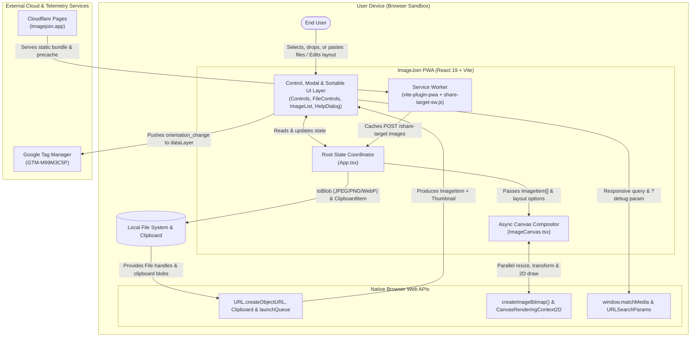
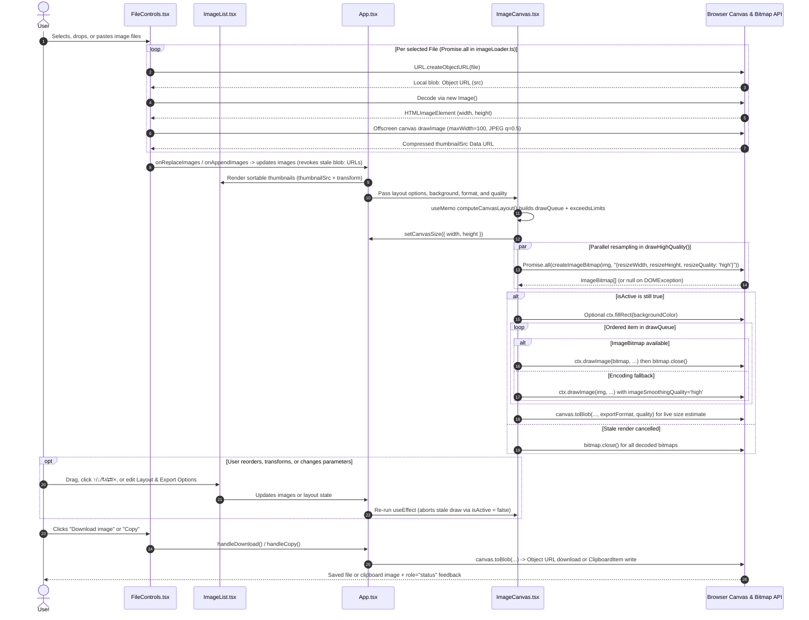
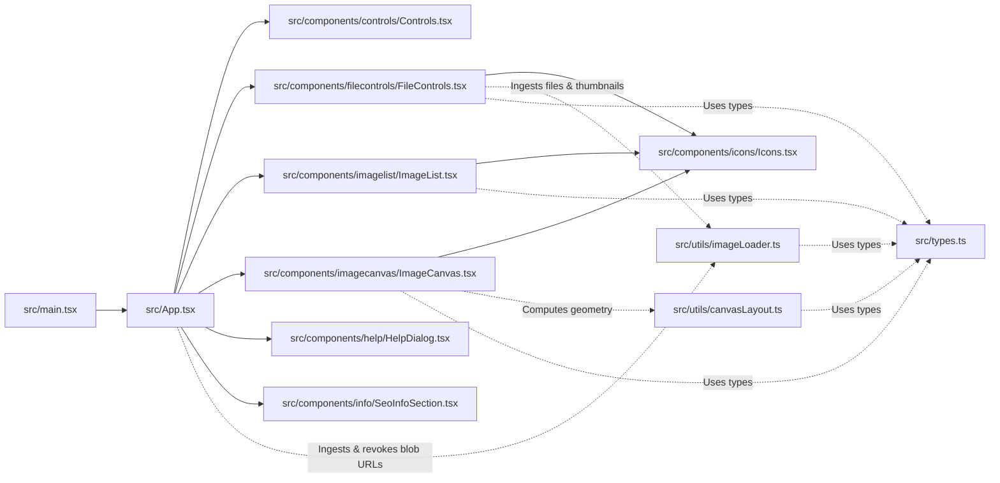
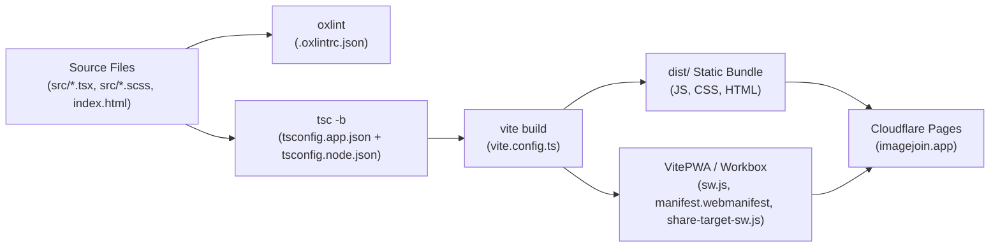

# ImageJoin Architecture Documentation

## 1. Executive Summary

**ImageJoin** (`imagejoinvite`) is a client-side Progressive Web Application (PWA) designed to combine, stack, arrange, transform, and export multiple images directly inside the browser using the HTML5 Canvas 2D API and the modern asynchronous `createImageBitmap` rendering pipeline. Built with React 19, TypeScript 7, and Vite 8, the application executes all image ingestion, aspect-ratio normalization, thumbnail generation, rotation/flipping, and final JPEG/PNG/WebP encoding locally on the user's device without requiring backend storage or server-side image processing.

The architecture prioritizes zero-server data privacy, responsive multi-device layout orchestration, and high-resolution rendering performance. By decoupling UI state management (such as intermediate text input and low-resolution drag-and-drop thumbnails) from expensive full-resolution canvas redraws, ImageJoin remains responsive even when manipulating large multi-megapixel source images.

| Aspect / Layer                | Technology / Choice                            | Version / Specification          | Role in Architecture                                                                           |
| :---------------------------- | :--------------------------------------------- | :------------------------------- | :--------------------------------------------------------------------------------------------- |
| **UI Runtime**                | React & React DOM                              | `^19.2.7`                        | Declarative component tree, state lifting, and effect lifecycle management                     |
| **Language & Type System**    | TypeScript                                     | `^7.0.2` (`ES2023` target)       | Compile-time type safety with strict bundler resolution and erasable syntax enforcement        |
| **Build Tool & Dev Server**   | Vite & `@vitejs/plugin-react`                  | `^8.3.8` / `^6.3.0`              | Oxc-powered fast HMR, ES module bundling, and asset pipeline                                   |
| **PWA & Offline Support**     | `vite-plugin-pwa`                              | `^2.0.0`                         | Service worker auto-update registration, Web App Manifest, `file_handlers`, and `share_target` |
| **Drag-and-Drop Engine**      | `@dnd-kit/react` & `@dnd-kit/helpers`          | `^0.5.3`                         | Accessible pointer/touch sortable list reordering for uploaded image items                     |
| **Rendering Engine**          | HTML5 Canvas 2D + `createImageBitmap`          | Browser Native Web API           | Asynchronous parallel image scaling (`resizeQuality: 'high'`), transforms, and compositing     |
| **Styling System**            | Sass (`sass-embedded`) + HTML5 Boilerplate CSS | `^1.108.2`                       | CSS custom properties, SCSS mixins, and mobile-first responsive media queries                  |
| **Static Analysis / Linting** | Oxlint                                         | `^1.95.0`                        | High-speed Rust-based linting enforcing React hooks and component export rules                 |
| **Testing Framework**         | Vitest + React Testing Library + jsdom         | `^5.1.2` / `^16.3.3` / `^31.0.1` | Unit, component, and DOM integration tests for utilities, canvas math, and UI workflows        |
| **Telemetry & Analytics**     | Google Tag Manager                             | `GTM-M99M3C5P`                   | Custom `dataLayer` interaction event telemetry (`orientation_change`)                          |

---

## 2. Repository Layout

The workspace follows a flat, modular single-page application structure with separated TypeScript compiler configurations for application code (`src/`) and Node-based build tooling ([`vite.config.ts`](./vite.config.ts)).

```text
imagejoin-react/
├── .oxlintrc.json                    # Oxlint static analysis rule and plugin configuration
├── .yarnrc.yml                       # Yarn 4 configuration (nodeLinker: node-modules)
├── ARCHITECTURE.md                   # Comprehensive system architecture and component manual
├── index.html                        # Entry HTML shell, SEO/OpenGraph metadata, and GTM bootstrap
├── package.json                      # Project manifest, scripts, and dependency declarations
├── yarn.lock                         # Yarn dependency lockfile
├── tsconfig.json                     # Solution-style TypeScript root config referencing app and node targets
├── tsconfig.app.json                 # TypeScript config for browser/DOM source code under src/
├── tsconfig.node.json                # TypeScript config for Vite & Vitest build configuration (Node environment)
├── vite.config.ts                    # Vite bundler and PWA manifest (file_handlers, share_target)
├── vitest.config.ts                  # Vitest + jsdom test runner configuration
├── public/                           # Static unbundled assets copied directly to dist root
│   ├── apple-touch-icon-180x180.png  # iOS home screen icon
│   ├── favicon.ico                   # Multi-size browser favicon (16x16, 32x32, 48x48)
│   ├── icon.svg                      # Scalable vector application icon
│   ├── maskable-icon-512x512.png     # Android adaptive maskable PWA icon
│   ├── pwa-64x64.png                 # Standard 64x64 PWA manifest icon
│   ├── pwa-192x192.png               # Standard 192x192 PWA manifest icon
│   ├── pwa-512x512.png               # Standard 512x512 PWA manifest icon
│   ├── robots.txt                    # Search crawler allow-all policy and sitemap pointer
│   ├── share-target-sw.js            # Workbox SW extension caching POST /share-target image files
│   ├── sitemap.xml                   # Canonical XML sitemap for search engine indexing
│   ├── img/
│   │   └── og-image.jpg              # OpenGraph and Twitter Card social preview banner
│   └── testimg/                      # Local-only test fixtures (git-ignored) for Debug mode
└── src/                              # Application source code
    ├── main.tsx                      # React 19 DOM root creation and StrictMode mounting
    ├── App.tsx                       # Root stateful container, drag-drop/paste/PWA ingestion, undo/error banners, and export/copy
    ├── App.test.tsx                  # End-to-end App upload, paste, drop, error banner, undo clear, copy, and download tests
    ├── App.scss                      # Design tokens, layout rules, empty-dropzone, slider/dialog, SEO footer, and responsive rules
    ├── index.css                     # Base HTML/reset styles and accessible .visually-hidden utility
    ├── types.ts                      # Core domain data contracts (ImageItem, Orientation, LayoutOptions)
    ├── test/
    │   ├── fixtures.ts               # Shared ImageItem, Canvas 2D, and matchMedia test helpers
    │   └── setup.ts                  # Vitest DOM setup, ResizeObserver/dialog stubs, and cleanup hooks
    ├── components/
    │   ├── controls/
    │   │   └── Controls.tsx          # Composition sidebar layout wrapper (#controls.controls)
    │   ├── filecontrols/
    │   │   ├── FileControls.tsx      # Accessible file pickers, SVG orientation toggles, width buffering, options, and export
    │   │   └── FileControls.test.tsx # File upload, width buffering/Auto reset, advanced options, and copy feedback tests
    │   ├── help/
    │   │   ├── HelpDialog.tsx        # Native <dialog> help & keyboard shortcuts modal
    │   │   └── HelpDialog.test.tsx   # Modal open/close behavior tests
    │   ├── icons/
    │   │   └── Icons.tsx             # Consistent inline SVG icon set for orientation, empty state, and thumbnail actions
    │   ├── imagecanvas/
    │   │   ├── ImageCanvas.tsx       # Parallel createImageBitmap compositor, empty-state dropzone, preview bar, and zoom viewport
    │   │   └── ImageCanvas.test.tsx  # Parallel resampling, empty dropzone, transforms, bitmap cleanup, and cancellation tests
    │   ├── imagelist/
    │   │   ├── ImageList.tsx         # Sortable thumbnail queue with drag-and-drop, rotate, flip, and remove
    │   │   └── ImageList.test.tsx    # Reordering, rotate/flip/remove/clear, and matchMedia tests
    │   └── info/
    │       └── SeoInfoSection.tsx    # Below-the-fold semantic product overview and FAQ section for users and crawlers
    └── utils/
        ├── analytics.ts              # Privacy-safe GTM dataLayer tracker and export snapshot builder
        ├── analytics.test.ts         # Unit tests for file-type extraction, snapshots, and stale-key clearing
        ├── canvasLayout.ts           # Pure Portrait/Landscape/Grid layout math, gap/padding, and limit checks
        ├── canvasLayout.test.ts      # Unit tests for Portrait/Landscape/Grid/Rotation layout formulas
        ├── imageLoader.ts            # Object URL file ingestion (Promise.allSettled partial recovery), thumbnails, and revocation
        └── imageLoader.test.ts       # Unit tests for file filtering, thumbnails, Object URLs, partial failure, and cleanup
```

### Configuration & Workspace Files

| File                                         | Purpose & Architectural Significance                                                                                                                                                                                                   |
| :------------------------------------------- | :------------------------------------------------------------------------------------------------------------------------------------------------------------------------------------------------------------------------------------- |
| [`package.json`](./package.json)             | Declares ESM package mode (`"type": "module"`), scripts (`dev`, `build`, `lint`, `preview`, `test`, `test:watch`), runtime dependencies, and build toolchains.                                                                         |
| [`vite.config.ts`](./vite.config.ts)         | Configures `@vitejs/plugin-react` and `VitePWA` (`registerType: 'autoUpdate'`, icon manifest, `file_handlers`, `share_target`, and [`public/share-target-sw.js`](./public/share-target-sw.js)).                                        |
| [`vitest.config.ts`](./vitest.config.ts)     | Configures Vitest with the `jsdom` environment, `@testing-library/jest-dom` setup, and test discovery under [`src/`](./src).                                                                                                           |
| [`tsconfig.json`](./tsconfig.json)           | Root project references file delegating compilation checks to [`tsconfig.app.json`](./tsconfig.app.json) and [`tsconfig.node.json`](./tsconfig.node.json).                                                                             |
| [`tsconfig.app.json`](./tsconfig.app.json)   | Configures `ES2023` + `DOM` libs, `bundler` module resolution, `react-jsx` transform, `verbatimModuleSyntax`, and `erasableSyntaxOnly` for [`src/`](./src).                                                                            |
| [`tsconfig.node.json`](./tsconfig.node.json) | Isolates Node-specific type checking (`nodenext`) strictly to [`vite.config.ts`](./vite.config.ts) and [`vitest.config.ts`](./vitest.config.ts).                                                                                       |
| [`.oxlintrc.json`](./.oxlintrc.json)         | Enables `react`, `typescript`, and `oxc` lint plugins, enforcing `react/rules-of-hooks` (`error`) and `react/only-export-components` (`warn`).                                                                                         |
| [`.yarnrc.yml`](./.yarnrc.yml)               | Configures Yarn 4 with `nodeLinker: node-modules` for Vite 8 compatibility.                                                                                                                                                            |
| [`index.html`](./index.html)                 | Mounts `#root`, injects the Google Tag Manager (`GTM-M99M3C5P`) script and `<noscript>` fallback, and defines OpenGraph/Twitter/PWA metadata plus `WebApplication` JSON-LD structured data. |
| [`.gitignore`](./.gitignore)                 | Excludes build artifacts (`dist/`), dependencies (`node_modules/`), Vitest cache (`.vitest`), local debug fixtures (`public/testimg`), and local workspace files (`.agents/`, `AGENTS.md`, `skills-lock.json`, `CLOUDFLARE_PAGES.md`, `og-image-hires.png`). |

---

## 3. System Context

ImageJoin operates as a standalone, browser-hosted Single Page Application (SPA) and Progressive Web Application (PWA). All core image processing stays within the browser's execution sandbox, interacting only with local host filesystem/clipboard APIs for file selection, paste/drop, and image export, and with external telemetry endpoints for usage analytics.



### External Boundaries & Interfaces

| Boundary                       | Direction                         | Protocol / Mechanism                                                                                                                   | Data Exchanged                                                                                                                |
| :----------------------------- | :-------------------------------- | :------------------------------------------------------------------------------------------------------------------------------------- | :---------------------------------------------------------------------------------------------------------------------------- |
| **User File Ingestion**        | Inbound (`LocalFS -> App`)        | `<input type="file">`, drag-drop, `paste`, `launchQueue`, and `share-target-sw.js` + `URL.createObjectURL`                             | Local raster image files mapped to in-memory `blob:` Object URLs and `HTMLImageElement` instances without Base64 duplication. |
| **Joined Image Export & Copy** | Outbound (`App -> LocalFS`)       | `HTMLCanvasElement.toBlob` (`image/jpeg`, `image/png`, `image/webp`) + `<a download>` or `navigator.clipboard.write` (`ClipboardItem`) | Composited image saved directly to the downloads folder as `<filename>.<ext>` or copied to the system clipboard as PNG.       |
| **Google Tag Manager**         | Outbound (`App -> sGTM -> GTM/GA4`) | `window.dataLayer.push()` via first-party loader [`index.html`](./index.html#L8-L22) -> `go.imagejoin.app`                               | Privacy-safe lifecycle, layout, interaction, and export/copy events without raw filenames.                                    |
| **PWA Service Worker**         | Bidirectional (`Browser <-> CDN`) | `vite-plugin-pwa` (`registerType: 'autoUpdate'`) + [`public/share-target-sw.js`](./public/share-target-sw.js)                          | Static asset precaching, offline execution capability, and local share-target Cache Storage handoff.                          |

---

## 4. Execution Flow

The primary operational lifecycle of ImageJoin spans four stages:

1. **Initialization & PWA Handoff**: Parsing query parameters (`?debug=true`, `?shared=1`), registering `window.launchQueue` (`file_handlers`), and mounting the React 19 component tree.
2. **Image Ingestion & Thumbnail Downsampling**: Mapping user-selected, dropped, or pasted `File` objects to local `blob:` Object URLs, decoding image dimensions concurrently, and generating compressed 100px-wide JPEG thumbnails via an offscreen canvas.
3. **Interactive Arrangement, Transform & Layout Calculation**: Reordering items via `@dnd-kit/react` or directional buttons, rotating/flipping/removing items, adjusting orientation (`portrait`, `landscape`, `grid`), spacing (`gap`, `padding`), sizing/alignment, and computing placement geometry in [`computeCanvasLayout`](./src/utils/canvasLayout.ts#L62-L216).
4. **Parallel High-Quality Compositing & Export**: Resizing all queued images concurrently using `createImageBitmap` with `resizeQuality: 'high'`, filling optional background colors, applying rotation/flip transforms, painting onto the shared `<canvas>`, immediately releasing bitmaps via `bitmap.close()`, estimating output size, and exporting via `canvas.toBlob` (Download or Copy).



---

## 5. Core Components



### 5.1 Application Bootstrap & Root State ([`src/main.tsx`](./src/main.tsx), [`src/App.tsx`](./src/App.tsx), [`src/types.ts`](./src/types.ts))

- **Entry Point ([`src/main.tsx`](./src/main.tsx#L1-L10))**: Mounts `<App />` inside `<StrictMode>` onto `#root` after importing global styles from [`src/index.css`](./src/index.css).
- **Domain & Telemetry Contracts ([`src/types.ts`](./src/types.ts#L1-L196))**:
  - `ImageItem` ([`src/types.ts`](./src/types.ts#L3-L15)): Encapsulates a loaded image's lifecycle data: unique `id` (`crypto.randomUUID()`), full-resolution `src` (Object URL or asset path), downsampled `thumbnailSrc`, `originalName`, natural `width` and `height`, `imgElement` (`HTMLImageElement`), optional `rotation` (`0 | 90 | 180 | 270`) and `flipH` (`boolean`), and optional `mimeType` / `fileSize` metadata for analytics.
  - `Orientation`, `SizeMode`, `Alignment`, `ExportFormat`, `LayoutOptions`, and `CanvasSize` ([`src/types.ts`](./src/types.ts#L17-L71)): Discriminated union and configuration contracts governing layout geometry and export formats.
  - `AnalyticsEvent`, `DataLayerEntry`, `LaunchParams`, and `Window` ([`src/types.ts`](./src/types.ts#L73-L220)): Strictly typed discriminated union for all 13 GTM `dataLayer` events and PWA `launchQueue` global declarations.
- **Root State Coordinator ([`src/App.tsx`](./src/App.tsx#L53-L660))**:
  - **Debug Mode Resolution ([`src/App.tsx`](./src/App.tsx#L54-L61))**: Evaluates `window.location.search` for `debug` and `window.location.hostname` for localhost (`localhost` or `127.0.0.1`). Debug mode is enabled automatically in Vite dev mode (`import.meta.env.DEV`) unless `?debug=false` is passed, or on localhost hostnames when `?debug=true` is explicitly provided.
  - **Lifted State, Undo & Error Handling ([`src/App.tsx`](./src/App.tsx#L63-L244))**: Manages `images`, `orientation`, `columns`, `sizeMode`, `alignment`, `gap`, `padding`, `backgroundColor`, `exportFormat`, `quality`, `filename`, `canvasSize`, `customWidth`, `isHelpOpen`, `isFileDragging`, `copyFeedback`, `errorBanner`, and `undoClearImages`. `clearImages` defers `revokeImageUrls` for 6 seconds with an inline `Undo` banner (`handleUndoClear`), while `removeImage` and `replaceImages` revoke superseded `blob:` URLs immediately.
  - **Multi-Channel File Ingestion ([`src/App.tsx`](./src/App.tsx#L144-L160), [`src/App.tsx`](./src/App.tsx#L272-L334), [`src/App.tsx`](./src/App.tsx#L494-L502))**: Shared `ingestFiles` helper powers global `paste` (`Cmd+V` / `Ctrl+V`), global `Files` drag-and-drop overlay, PWA `window.launchQueue` (`file_handlers`), and `?shared=1` Cache Storage retrieval (`share-target-sw.js`), surfacing `role="alert"` error banners for skipped files.
  - **Export & Clipboard Handlers ([`src/App.tsx`](./src/App.tsx#L335-L466))**: `handleDownload()` fills transparent backgrounds with white when exporting JPEG and encodes via `canvas.toBlob(..., exportFormat, quality)` into a temporary Object URL (with `toDataURL` fallback). `handleCopy()` writes a PNG `Blob` via `navigator.clipboard.write([new ClipboardItem({ 'image/png': blob })])` and updates `copyFeedback` with repeated-message deduplication (`\u00A0`).
  - **Below-the-Fold Product Overview ([`src/components/info/SeoInfoSection.tsx`](./src/components/info/SeoInfoSection.tsx#L1-L68))**: Renders concise semantic documentation and FAQs beneath `<main>` for user onboarding and search engine crawlability without obstructing the editor viewport.

### 5.2 Control Panel, Help Modal & Ingestion Pipeline ([`src/components/controls/Controls.tsx`](./src/components/controls/Controls.tsx), [`src/components/filecontrols/FileControls.tsx`](./src/components/filecontrols/FileControls.tsx), [`src/components/help/HelpDialog.tsx`](./src/components/help/HelpDialog.tsx), [`src/components/icons/Icons.tsx`](./src/components/icons/Icons.tsx), [`src/utils/imageLoader.ts`](./src/utils/imageLoader.ts))

- **Sidebar Wrapper ([`src/components/controls/Controls.tsx`](./src/components/controls/Controls.tsx#L3-L15))**: Stateless composition container (`#controls.controls`) rendering `children`.
- **Help & Shortcuts Modal ([`src/components/help/HelpDialog.tsx`](./src/components/help/HelpDialog.tsx#L8-L142))**: Native top-layer `<dialog closedby="any">` opened via `showModal()` from `#helpButton`, using `<h2>`/`<h3>` headings and a pointerdown/pointerup light-dismiss fallback for browsers without `closedBy` support.
- **Image Loader & Thumbnail Utility ([`src/utils/imageLoader.ts`](./src/utils/imageLoader.ts#L8-L148))**:
  - `filterImageFiles(files)` ([`src/utils/imageLoader.ts`](./src/utils/imageLoader.ts#L8-L12)): Filters files by `image/*` MIME type or raster image extension.
  - `generateThumbnail(img, maxWidth = 100)` ([`src/utils/imageLoader.ts`](./src/utils/imageLoader.ts#L18-L30)): Renders a 100px max-width downscaled image onto an ephemeral `<canvas>` and exports a lightweight JPEG (`quality = 0.5`).
  - `loadImage(src, name)` ([`src/utils/imageLoader.ts`](./src/utils/imageLoader.ts#L40-L66)): Decodes an `HTMLImageElement`, generates its thumbnail, and assigns `crypto.randomUUID()` with `rotation: 0` and `flipH: false`.
  - `loadImageFilesDetailed(files)` ([`src/utils/imageLoader.ts`](./src/utils/imageLoader.ts#L77-L115)): Uses `Promise.allSettled` to keep valid images when individual files are unsupported or fail to decode, revoking only failed Object URLs and returning `{ loaded, failedNames }`.
  - `loadImageFiles(files)` ([`src/utils/imageLoader.ts`](./src/utils/imageLoader.ts#L121-L137)): Strict batch loader that revokes all created Object URLs if any file fails to load.
  - `revokeImageUrls(images)` ([`src/utils/imageLoader.ts`](./src/utils/imageLoader.ts#L142-L148)): Revokes `blob:` URLs while ignoring static debug fixture paths.
- **File & Parameter Controls ([`src/components/filecontrols/FileControls.tsx`](./src/components/filecontrols/FileControls.tsx#L71-L681))**:
  - **Accessible Replace & Append Pickers ([`src/components/filecontrols/FileControls.tsx`](./src/components/filecontrols/FileControls.tsx#L114-L146), [`src/components/filecontrols/FileControls.tsx`](./src/components/filecontrols/FileControls.tsx#L262-L299))**: `#upload` (`Choose Files` / `Replace`) and `#addUpload` (`+ Add`) use `.visually-hidden` so keyboard users retain full Tab/focus-ring access.
  - **SVG Segmented Orientation Toggle ([`src/components/filecontrols/FileControls.tsx`](./src/components/filecontrols/FileControls.tsx#L301-L343))**: Uses inline icons from [`Icons.tsx`](./src/components/icons/Icons.tsx) paired with concise labels (`Stack`, `Row`, `Grid`).
  - **Analytics Utility ([`src/utils/analytics.ts`](./src/utils/analytics.ts#L1-L212))**: Centralizes `trackEvent()` (with `is_debug_mode` tagging for localhost/dev and Data Layer v2 stale-key cleanup between pushes) and `buildExportSnapshot()`, emitting 13 privacy-safe events (including `undo_clear`, `file_ingest_error`, `empty_dropzone_browse`, and `faq_toggle`) without exposing raw filenames.
  - **Buffered Custom Width & Reset ([`src/components/filecontrols/FileControls.tsx`](./src/components/filecontrols/FileControls.tsx#L105-L110), [`src/components/filecontrols/FileControls.tsx`](./src/components/filecontrols/FileControls.tsx#L186-L240), [`src/components/filecontrols/FileControls.tsx`](./src/components/filecontrols/FileControls.tsx#L376-L413))**: Buffers keystrokes in `localWidth`, surfaces a dirty `Go` indicator (`Press Enter or click Go to apply width`), provides a one-click `Auto` reset button when applied, and explains why `#sizeMode` is disabled while custom width is active.
  - **Layout & Export Options (`<details className="advanced-options">`) ([`src/components/filecontrols/FileControls.tsx`](./src/components/filecontrols/FileControls.tsx#L418-L633))**: Exposes `Sizing`, `Align`, `Gap (px)`, `Pad (px)`, `Background` presets + custom color picker, `Format` (`JPEG`, `PNG`, `WebP`), and `Quality` slider (hidden for PNG).
  - **Export & Copy Actions ([`src/components/filecontrols/FileControls.tsx`](./src/components/filecontrols/FileControls.tsx#L645-L678))**: Renders `#download` (primary action accent) and `#copyImage` paired with an external `role="status"` live feedback badge.

### 5.3 Canvas Layout Math & Rendering Engine ([`src/utils/canvasLayout.ts`](./src/utils/canvasLayout.ts), [`src/components/imagecanvas/ImageCanvas.tsx`](./src/components/imagecanvas/ImageCanvas.tsx))

[`computeCanvasLayout`](./src/utils/canvasLayout.ts#L62-L216) computes target canvas dimensions, placement coordinates, and `exceedsLimits` synchronously (accounting for per-image `rotation`, `gap`, `padding`, `sizeMode`, `alignment`, and `columns`), while [`ImageCanvas`](./src/components/imagecanvas/ImageCanvas.tsx#L35-L229) applies those dimensions and executes parallel asynchronous bitmap resampling:

| Orientation Mode                                                                                      | Width Mode                       | Target Base Dimension Formula                                                                                   | Individual Image Scaling Formula                                                    | Final Canvas Dimensions                                                                                                                      |
| :---------------------------------------------------------------------------------------------------- | :------------------------------- | :-------------------------------------------------------------------------------------------------------------- | :---------------------------------------------------------------------------------- | :------------------------------------------------------------------------------------------------------------------------------------------- |
| **Portrait** (Vertical Stack) ([`src/utils/canvasLayout.ts`](./src/utils/canvasLayout.ts#L89-L125))   | Auto (`customWidth` empty)       | $W_{\text{base}} = \max(W_i)$ (`largest`), $\min(W_i)$ (`smallest`), or natural $W_i$ (`original`)              | $s_i = \frac{W_{\text{base}}}{W_i}$ (or $1$ for `original`), $H'_i = H_i \cdot s_i$ | $W_{\text{canvas}} = W_{\text{base}} + 2P$<br>$H_{\text{canvas}} = \sum H'_i + G(n-1) + 2P$                                                  |
| **Portrait** (Vertical Stack) ([`src/utils/canvasLayout.ts`](./src/utils/canvasLayout.ts#L89-L125))   | Custom (`parsedCustomWidth > 0`) | $W_{\text{base}} = \max(1, W_{\text{custom}} - 2P)$                                                             | $s_i = \frac{W_{\text{base}}}{W_i}, \quad H'_i = H_i \cdot s_i$                     | $W_{\text{canvas}} = W_{\text{custom}}$<br>$H_{\text{canvas}} = \sum H'_i + G(n-1) + 2P$                                                     |
| **Landscape** (Horizontal Row) ([`src/utils/canvasLayout.ts`](./src/utils/canvasLayout.ts#L126-L162)) | Auto (`customWidth` empty)       | $H_{\text{base}} = \max(H_i)$ (`largest`), $\min(H_i)$ (`smallest`), or natural $H_i$ (`original`)              | $s_i = \frac{H_{\text{base}}}{H_i}$ (or $1$ for `original`), $W'_i = W_i \cdot s_i$ | $W_{\text{canvas}} = \sum W'_i + G(n-1) + 2P$<br>$H_{\text{canvas}} = H_{\text{base}} + 2P$                                                  |
| **Landscape** (Horizontal Row) ([`src/utils/canvasLayout.ts`](./src/utils/canvasLayout.ts#L126-L162)) | Custom (`parsedCustomWidth > 0`) | $H_{\text{base}} = \frac{\max(1, W_{\text{custom}} - 2P - G(n-1))}{\sum (W_i / H_i)}$                           | $s_i = \frac{H_{\text{base}}}{H_i}, \quad W'_i = W_i \cdot s_i$                     | $W_{\text{canvas}} = W_{\text{custom}}$<br>$H_{\text{canvas}} = H_{\text{base}} + 2P$                                                        |
| **Grid** ($C$ Columns) ([`src/utils/canvasLayout.ts`](./src/utils/canvasLayout.ts#L163-L209))         | Auto or Custom                   | $W_{\text{cell}} = \frac{W_{\text{custom}} - 2P - G(C_{\text{used}}-1)}{C_{\text{used}}}$ (or $\max/\min(W_i)$) | Scaled to $W_{\text{cell}}$ (or `original`), aligned inside each row's $\max(H'_r)$ | $W_{\text{canvas}} = C_{\text{used}} W_{\text{cell}} + G(C_{\text{used}}-1) + 2P$<br>$H_{\text{canvas}} = \sum H_{\text{row}} + G(R-1) + 2P$ |

- **Parallel Resampling, Transforms, Bitmap Disposal & Cancellation ([`src/components/imagecanvas/ImageCanvas.tsx`](./src/components/imagecanvas/ImageCanvas.tsx#L68-L188))**: `drawHighQuality()` resamples all `drawQueue` items concurrently to `(drawW, drawH)` via `Promise.all`, checks `isActive` before painting, fills `backgroundColor` if non-transparent, applies `ctx.translate` / `ctx.rotate` / `ctx.scale` when `rotation !== 0 || flipH`, and guarantees `bitmap.close()` in both the active draw `finally` block and the cancelled-render cleanup path.
- **Preview Toolbar, Empty Dropzone, Size Estimate & Limit Warning ([`src/components/imagecanvas/ImageCanvas.tsx`](./src/components/imagecanvas/ImageCanvas.tsx#L211-L280))**: Renders an interactive empty-state dropzone when no images are queued (triggering the file picker, drag-drop, or paste), displays live `${canvasSize.width} × ${canvasSize.height} px` and asynchronous `canvas.toBlob` size estimate when active, toggles between `Fit View` and `100% Zoom`, renders a CSS checkerboard pattern behind transparent canvases, and displays a `role="status"` warning when `layout.exceedsLimits` is true.

### 5.4 Sortable Image Queue ([`src/components/imagelist/ImageList.tsx`](./src/components/imagelist/ImageList.tsx))

- **`SortableImageItem` ([`src/components/imagelist/ImageList.tsx`](./src/components/imagelist/ImageList.tsx#L33-L119))**: Binds each image entry to `@dnd-kit/react/sortable` via `useSortable({ id, index })`. Displays accessible inline SVG action buttons from [`Icons.tsx`](./src/components/icons/Icons.tsx) (move up, rotate 90°, flip horizontally, move down, and remove), the compressed `img.thumbnailSrc` with CSS preview transform and context-menu suppression (`onContextMenu={(e) => e.preventDefault()}`), and the truncated `originalName`.
- **`ImageList` ([`src/components/imagelist/ImageList.tsx`](./src/components/imagelist/ImageList.tsx#L132-L232))**:
  - Wraps items in `<DragDropProvider onDragEnd={handleDragEnd}>` ([`src/components/imagelist/ImageList.tsx`](./src/components/imagelist/ImageList.tsx#L135-L147)), delegating drag reordering to `move(prevImages, event)` from `@dnd-kit/helpers`.
  - Provides explicit button reordering (`swapImages`, `moveUp`, `moveDown`), per-item rotate/flip/remove callbacks, and a `Clear all` button ([`src/components/imagelist/ImageList.tsx`](./src/components/imagelist/ImageList.tsx#L168-L171)).
  - Lazily initializes `#helpText` from `window.matchMedia('(max-width: 600px)').matches` and subscribes to `change` events ([`src/components/imagelist/ImageList.tsx`](./src/components/imagelist/ImageList.tsx#L114-L148)).

---

## 6. Design Decisions

| Decision                                                                                                                                                                                                                                                       | Rationale                                                                                                                                                                                                                                                                                                                                       | Trade-off                                                                                                                                                                                             |
| :------------------------------------------------------------------------------------------------------------------------------------------------------------------------------------------------------------------------------------------------------------- | :---------------------------------------------------------------------------------------------------------------------------------------------------------------------------------------------------------------------------------------------------------------------------------------------------------------------------------------------- | :---------------------------------------------------------------------------------------------------------------------------------------------------------------------------------------------------- |
| **100% Client-Side Canvas Processing** ([`src/components/imagecanvas/ImageCanvas.tsx`](./src/components/imagecanvas/ImageCanvas.tsx#L87-L169))                                                                                                                 | Eliminates server bandwidth costs, backend infrastructure complexity, and user privacy concerns by keeping all image bytes in local browser memory.                                                                                                                                                                                             | Maximum image resolution and batch size are constrained by the client device's RAM and browser-enforced maximum `<canvas>` dimensions (typically 16,384px–32,767px per axis).                         |
| **Object URL Ingestion & `toBlob` Export** ([`src/utils/imageLoader.ts`](./src/utils/imageLoader.ts#L60-L84), [`src/App.tsx`](./src/App.tsx#L223-L249))                                                                                                        | Avoids ~33% Base64 encoding overhead on upload and prevents synchronous main-thread Data URL string blocking on export.                                                                                                                                                                                                                         | Requires explicit `URL.revokeObjectURL` management in `replaceImages()` / `removeImage()` ([`src/App.tsx`](./src/App.tsx#L69-L87)) rather than effect cleanup to stay safe under React 19 StrictMode. |
| **Dual-Resolution Image State (`src` vs `thumbnailSrc`)** ([`src/types.ts`](./src/types.ts#L3-L13), [`src/utils/imageLoader.ts`](./src/utils/imageLoader.ts#L18-L30))                                                                                          | Decoding and painting multi-megapixel images inside draggable DOM nodes causes layout thrashing and GPU memory spikes during drag gestures. Generating a 100px JPEG thumbnail (`q=0.5`) at upload time keeps list interactions at 60fps.                                                                                                        | Adds a small upfront CPU/canvas cost during initial file upload and stores a tiny secondary Data URL string per image in memory.                                                                      |
| **Parallel `createImageBitmap` Resampling with Explicit `close()`** ([`src/components/imagecanvas/ImageCanvas.tsx`](./src/components/imagecanvas/ImageCanvas.tsx#L88-L169))                                                                                    | Standard 2D `ctx.drawImage` downscaling in many browsers produces aliasing artifacts. Running `createImageBitmap` (`resizeQuality: 'high'`) concurrently via `Promise.all` speeds up multi-image redraws while `bitmap.close()` frees GPU textures immediately.                                                                                 | Asynchronous decoding requires an `isActive` cancellation flag to dispose stale bitmaps and prevent out-of-order writes.                                                                              |
| **White-Backed Offscreen Composite for Transparent JPEG Export** ([`src/App.tsx`](./src/App.tsx#L204-L219))                                                                                                                                                    | JPEG does not support an alpha channel, causing transparent canvases to turn solid black when exported directly. Painting onto a temporary white-backed canvas only when `exportFormat === 'image/jpeg' && backgroundColor === 'transparent'` preserves checkerboard preview accuracy while yielding clean white backgrounds in JPEG downloads. | Allocates one transient composite canvas during JPEG export when background is `transparent`.                                                                                                         |
| **Render-Time Derived Layout via `useMemo`** ([`src/components/imagecanvas/ImageCanvas.tsx`](./src/components/imagecanvas/ImageCanvas.tsx#L54-L66))                                                                                                            | Computing `computeCanvasLayout` during render exposes `exceedsLimits` synchronously without triggering extra `setState` passes inside `useEffect` (satisfying React 19 compiler lint rules).                                                                                                                                                    | Layout recalculates synchronously on render before paint whenever `images` or layout options change.                                                                                                  |
| **Native `<dialog>` Modal & `role="status"` Copy Feedback** ([`src/components/help/HelpDialog.tsx`](./src/components/help/HelpDialog.tsx#L8-L139), [`src/components/filecontrols/FileControls.tsx`](./src/components/filecontrols/FileControls.tsx#L419-L441)) | Native `<dialog>` provides top-layer rendering, `Esc` dismissal, and inert background behavior without third-party overlay dependencies; an external `opacity`-toggled `role="status"` node announces clipboard outcomes cleanly without disabling the Copy button.                                                                             | Safari lacks `closedBy="any"` on `<dialog>`, requiring a small pointerdown/pointerup backdrop fallback ([`src/components/help/HelpDialog.tsx`](./src/components/help/HelpDialog.tsx#L35-L58)).        |

---

## 7. Deployment & Environment

### Build Pipeline & Tooling



### Yarn Lifecycle Scripts

| Command ([`package.json`](./package.json#L6-L13)) | Underlying Execution   | Purpose                                                                                                                                                                                    |
| :------------------------------------------------ | :--------------------- | :----------------------------------------------------------------------------------------------------------------------------------------------------------------------------------------- |
| `yarn dev`                                        | `vite`                 | Launches the local Vite development server with HMR and activates `import.meta.env.DEV` (enabling the Debug UI toggle by default).                                                         |
| `yarn build`                                      | `tsc -b && vite build` | Runs TypeScript composite project verification across both `tsconfig.app.json` and `tsconfig.node.json`, then bundles production assets and generates the PWA service worker into `dist/`. |
| `yarn lint`                                       | `oxlint`               | Executes Rust-powered static analysis using rules from [`.oxlintrc.json`](./.oxlintrc.json).                                                                                               |
| `yarn preview`                                    | `vite preview`         | Serves the production `dist/` directory locally to verify PWA service worker registration and bundled behavior.                                                                            |
| `yarn test`                                       | `vitest run`           | Runs the Vitest unit and component integration test suite once in `jsdom`.                                                                                                                 |
| `yarn test:watch`                                 | `vitest`               | Runs Vitest in interactive watch mode during development.                                                                                                                                  |

### Operational Prerequisites & Environment Variables

- **Node.js & Package Manager**: Uses ES Modules (`"type": "module"`) managed via Yarn 4 (`yarn@4.18.1`) configured with `nodeLinker: node-modules` in [`.yarnrc.yml`](./.yarnrc.yml) and [`yarn.lock`](./yarn.lock).
- **Hosting Target**: Deployed as a static site on Cloudflare Pages (`https://imagejoin.app`), referenced in canonical, OpenGraph, and Twitter tags in [`index.html`](./index.html#L27-L73).
- **Runtime Flags**:
  - `import.meta.env.DEV` ([`src/App.tsx`](./src/App.tsx#L44)): Automatically injected by Vite; controls default visibility of `#debugContainer`.
  - `?debug=true` / `?debug=false` ([`src/App.tsx`](./src/App.tsx#L39-L45)): URL query parameter to override debug fixture controls in Vite dev mode or on `localhost` / `127.0.0.1`.
  - `?shared=1` ([`src/App.tsx`](./src/App.tsx#L169-L202)): Query trigger written by [`public/share-target-sw.js`](./public/share-target-sw.js) after intercepting a `POST /share-target` PWA share payload.

### Local Debug Fixture Generation

Because `public/testimg` is excluded from Git in [`.gitignore`](./.gitignore#L5), generate the 6 local debug images referenced by `TEST_IMAGES` in [`src/components/filecontrols/FileControls.tsx`](./src/components/filecontrols/FileControls.tsx#L11-L18) using ImageMagick (`magick`):

```bash
# On macOS, pass an explicit system font; on Linux, adjust FONT to a local .ttf/.otf path
FONT="/System/Library/Fonts/Helvetica.ttc"
mkdir -p public/testimg

magick -size 600x1200 xc:none \
  -stroke "#2563eb" -strokewidth 12 -fill "rgba(37,99,235,0.18)" \
  -draw "roundrectangle 20,20 580,1180 40,40" \
  -font "$FONT" -stroke none -fill "#1e293b" -pointsize 64 \
  -gravity North -annotate +0+60 "TOP" \
  -gravity West -annotate +40+0 "L" \
  -gravity East -annotate +40+0 "R" \
  -gravity South -annotate +0+60 "BOTTOM" \
  public/testimg/01-tall-portrait.png

magick -size 1600x400 gradient:"#0f172a-#334155" \
  -stroke "rgba(255,255,255,0.35)" -strokewidth 2 \
  -draw "line 0,100 1600,100 line 0,200 1600,200 line 0,300 1600,300 line 400,0 400,400 line 800,0 800,400 line 1200,0 1200,400" \
  -font "$FONT" -stroke none -fill "#f8fafc" -pointsize 48 -gravity Center -annotate +0+0 "1600x400 WIDE" \
  -quality 90 public/testimg/02-wide-landscape.jpg

magick -size 64x64 xc:none \
  -fill "#ef4444" -draw "rectangle 0,0 20,20" \
  -fill "#22c55e" -draw "rectangle 44,44 63,63" \
  -fill "#f59e0b" -draw "circle 32,32 32,16" \
  public/testimg/03-tiny-icon.png

magick -size 800x800 xc:none \
  -fill "#8b5cf6" -draw "circle 400,400 400,60" \
  -font "$FONT" -fill "#ffffff" -pointsize 64 -gravity Center -annotate +0+0 "WEBP\nALPHA" \
  public/testimg/04-square-alpha.webp

magick -size 4000x3000 plasma:fractal \
  -fill "rgba(0,0,0,0.45)" -draw "rectangle 1200,1300 2800,1700" \
  -font "$FONT" -fill "#ffffff" -pointsize 140 -gravity Center -annotate +0+0 "4000x3000" \
  -quality 85 public/testimg/05-highres-stress.jpg

magick -size 500x700 xc:"rgba(16,185,129,0.55)" \
  -stroke "#065f46" -strokewidth 16 -fill none -draw "rectangle 8,8 492,692" \
  -font "$FONT" -stroke none -fill "#ffffff" -pointsize 48 -gravity Center -annotate +0+0 "500x700\n55% ALPHA" \
  public/testimg/06-very-long-filename-for-list-truncation-check.png
```

---

## 8. Security & Privacy

Because ImageJoin is an offline-capable client-side utility, its security posture centers on browser sandbox isolation and strict zero-upload image handling:

1. **Zero Remote Image Transmission**:
   - User-uploaded, dropped, pasted, and shared files are mapped strictly to local `blob:` Object URLs via `URL.createObjectURL()` ([`src/utils/imageLoader.ts`](./src/utils/imageLoader.ts#L60-L73)) and decoded into local `HTMLImageElement` instances. No image binary data, filenames, or canvas outputs are ever transmitted over the network.
2. **Trust Boundaries & Third-Party Scripts**:
   - **Google Tag Manager (`GTM-M99M3C5P` via sGTM `go.imagejoin.app`)**: Loaded asynchronously via the first-party server-side container path `https://go.imagejoin.app/cEwszCUvNx36/` in [`index.html`](./index.html#L8-L22), routing GA4 hits (`G-G10GWJPG4Y`) to `https://go.imagejoin.app`. Telemetry in [`src/utils/analytics.ts`](./src/utils/analytics.ts#L37-L168) strictly strips raw filenames and custom filename strings, sending only privacy-safe metadata (`file_types`, `image_count`, `has_custom_filename`, layout/export settings).
3. **Input Validation & Sanitization**:
   - **Custom Width, Gap, Padding & Columns Parsing**: Numeric inputs are parsed and clamped (`gap`/`padding` `0–200`, `columns` `1–12`, `customWidth > 0`) before reaching [`computeCanvasLayout`](./src/utils/canvasLayout.ts#L68-L82).
   - **Download Filename Handling**: Export filenames are trimmed via `filename.trim() || 'joinedimage'` and assigned to the `download` attribute of an in-memory `<a>` element ([`src/App.tsx`](./src/App.tsx#L27-L32), [`src/App.tsx`](./src/App.tsx#L223-L249)), which browsers automatically sanitize against path traversal characters.
   - **Production Debug Gating**: The debug fixture toggle is explicitly restricted outside `import.meta.env.DEV` to `localhost` and `127.0.0.1` hostnames ([`src/App.tsx`](./src/App.tsx#L39-L45)).

---

## 9. Performance Characteristics

| Subsystem                        | BottleneckType             | Mechanism & Optimization Strategy                                                                                                                                              | Code Reference                                                                                                                                                                                                       |
| :------------------------------- | :------------------------- | :----------------------------------------------------------------------------------------------------------------------------------------------------------------------------- | :------------------------------------------------------------------------------------------------------------------------------------------------------------------------------------------------------------------- |
| **File Ingestion & Decoding**    | I/O + Memory               | Maps files to zero-copy `URL.createObjectURL(file)` handles and decodes concurrently via `Promise.all`, revoking superseded `blob:` URLs on replace/remove.                    | [`src/utils/imageLoader.ts`](./src/utils/imageLoader.ts#L60-L84), [`src/App.tsx`](./src/App.tsx#L69-L105)                                                                                                            |
| **Sortable List Rendering**      | DOM / GPU Memory           | Downsamples every uploaded image immediately to a max-width 100px JPEG (`quality = 0.5`) stored in `thumbnailSrc`, reducing thumbnail memory footprint by >99%.                | [`src/utils/imageLoader.ts`](./src/utils/imageLoader.ts#L18-L30), [`src/components/imagelist/ImageList.tsx`](./src/components/imagelist/ImageList.tsx#L50-L59)                                                       |
| **High-Resolution Resampling**   | CPU / GPU                  | Resamples all `drawQueue` items concurrently via `Promise.all(createImageBitmap(..., { resizeQuality: 'high' }))` and releases GPU textures immediately with `bitmap.close()`. | [`src/components/imagecanvas/ImageCanvas.tsx`](./src/components/imagecanvas/ImageCanvas.tsx#L88-L169)                                                                                                                |
| **Rapid Reorder Cancellation**   | Concurrency / CPU          | Aborts stale `drawHighQuality()` commits via the `isActive` effect cleanup flag and closes any decoded bitmaps from cancelled renders.                                         | [`src/components/imagecanvas/ImageCanvas.tsx`](./src/components/imagecanvas/ImageCanvas.tsx#L69), [`src/components/imagecanvas/ImageCanvas.tsx`](./src/components/imagecanvas/ImageCanvas.tsx#L102-L186)             |
| **Width Input Isolation**        | React Re-render Prevention | Buffers keystrokes in `localWidth` inside `FileControls` so `ImageCanvas` only recalculates when the user commits via `Enter` or `Go`.                                         | [`src/components/filecontrols/FileControls.tsx`](./src/components/filecontrols/FileControls.tsx#L88-L93), [`src/components/filecontrols/FileControls.tsx`](./src/components/filecontrols/FileControls.tsx#L143-L164) |
| **Multi-Format Export Encoding** | Memory / Main Thread       | Encodes the final composite asynchronously via `canvas.toBlob(..., exportFormat, quality)` into a temporary Object URL (falling back to `toDataURL` if unavailable).           | [`src/App.tsx`](./src/App.tsx#L223-L249)                                                                                                                                                                             |

### Known Resource Ceiling

- **Browser Canvas Limits**: Modern desktop and mobile browsers enforce hard limits on `<canvas>` backing store dimensions (commonly 16,384 $\times$ 16,384 pixels or ~268 megapixels total area). Stacking many unscaled 4K/8K images in portrait mode with `sizeMode = 'largest'` can exceed this ceiling; `ImageCanvas` surfaces a warning banner whenever `layout.exceedsLimits` is true.

---

## 10. Troubleshooting

| Symptom                                                                                    | Cause                                                                                                                                                                                                                                                                                                                                                      | Fix                                                                                                                                                                                                                                |
| :----------------------------------------------------------------------------------------- | :--------------------------------------------------------------------------------------------------------------------------------------------------------------------------------------------------------------------------------------------------------------------------------------------------------------------------------------------------------- | :--------------------------------------------------------------------------------------------------------------------------------------------------------------------------------------------------------------------------------- |
| **Typing a number in the "Width" field does not resize the canvas**                        | `FileControls` buffers keystrokes in `localWidth` to prevent expensive canvas redraws on every character typed ([`src/components/filecontrols/FileControls.tsx`](./src/components/filecontrols/FileControls.tsx#L88-L93)).                                                                                                                                 | Press the `Enter` key while focused in `#customWidth` or click the adjacent **Go** button to trigger `applyWidth()` ([`src/components/filecontrols/FileControls.tsx`](./src/components/filecontrols/FileControls.tsx#L143-L164)).  |
| **"Sizing" select is greyed out and unclickable**                                          | A custom width is currently active (`hasCustomWidth` is `true` when `localWidth.trim() !== ''`), which overrides `sizeMode` selection ([`src/components/filecontrols/FileControls.tsx`](./src/components/filecontrols/FileControls.tsx#L242), [`src/components/filecontrols/FileControls.tsx`](./src/components/filecontrols/FileControls.tsx#L430-L450)). | Click the **Auto** reset button next to **Width** (or clear the text inside **Width** and click **Go** / press `Enter`) to reset `customWidth` to `''`.                                                                                                       |
| **Transparent PNG background turns white on JPEG export**                                  | JPEG has no alpha channel; [`getExportSourceCanvas`](./src/App.tsx#L204-L221) composites transparent canvases onto white for JPEG exports to avoid black artifacts.                                                                                                                                                                                        | Switch **Format** in **Layout & Export Options** to `PNG (.png)` or `WebP (.webp)` to preserve transparency.                                                                                                                       |
| **Copy button shows "Copy failed"**                                                        | `navigator.clipboard.write` requires a secure context (`https:` or `localhost`) and clipboard write permission.                                                                                                                                                                                                                                            | Serve over HTTPS or localhost and grant clipboard permissions, or use **Download image**.                                                                                                                                          |
| **Toggling the "Debug" checkbox logs `Failed to load: testimg/...` and renders no images** | The `public/testimg` directory is excluded from version control in [`.gitignore`](./.gitignore#L5), so the six fixture paths in `TEST_IMAGES` ([`src/components/filecontrols/FileControls.tsx`](./src/components/filecontrols/FileControls.tsx#L11-L18)) are missing on fresh clones. | Create `public/testimg/` locally and populate it with the expected test images (`01-tall-portrait.png`, `02-wide-landscape.jpg`, `03-tiny-icon.png`, `04-square-alpha.webp`, `05-highres-stress.jpg`, and `06-very-long-filename-for-list-truncation-check.png`). |
| **Debug checkbox does not appear when appending `?debug=true` on production**              | [`src/App.tsx`](./src/App.tsx#L39-L45) restricts `?debug=true` outside Vite dev mode to `localhost` and `127.0.0.1` hostnames.                                                                                                                                                                                                                             | Run the application locally via `yarn dev`, or run `yarn preview` on `localhost` / `127.0.0.1` with `?debug=true`.                                                                                                                 |
| **Warning banner says output exceeds browser canvas limits**                               | Total composited width/height exceeds 16,384 px or area exceeds 268 MP ([`src/utils/canvasLayout.ts`](./src/utils/canvasLayout.ts#L206-L209)).                                                                                                                                                                                                             | Enter a lower target pixel width (e.g., `2000` or `4000`) in **Width** and click **Go**, or set **Sizing** to `Match smallest`.                                                                                                    |
| **Canvas renders with standard smoothing instead of `createImageBitmap`**                  | Fractional pixel dimensions or unsupported colour profiles caused `createImageBitmap` to throw a `DOMException` in strict browser engines.                                                                                                                                                                                                                 | Handled automatically by the `catch` fallback in [`src/components/imagecanvas/ImageCanvas.tsx`](./src/components/imagecanvas/ImageCanvas.tsx#L96-L168), which falls back to `ctx.drawImage` with `imageSmoothingQuality = 'high'`. |

---

## 11. Appendices

### 11.1 Reading Paths

| Persona                              | Recommended Section Sequence                                                                                                                                                                  | Key Files to Inspect First                                                                                                                                                                                         |
| :----------------------------------- | :-------------------------------------------------------------------------------------------------------------------------------------------------------------------------------------------- | :----------------------------------------------------------------------------------------------------------------------------------------------------------------------------------------------------------------- |
| **New Contributor**                  | **1. Executive Summary** $\rightarrow$ **2. Repository Layout** $\rightarrow$ **4. Execution Flow** $\rightarrow$ **5. Core Components**                                                      | [`src/types.ts`](./src/types.ts), [`src/App.tsx`](./src/App.tsx), [`src/utils/imageLoader.ts`](./src/utils/imageLoader.ts), [`src/utils/canvasLayout.ts`](./src/utils/canvasLayout.ts)                             |
| **Operator / DevOps**                | **1. Executive Summary** $\rightarrow$ **3. System Context** $\rightarrow$ **7. Deployment & Environment** $\rightarrow$ **10. Troubleshooting**                                              | [`package.json`](./package.json), [`vite.config.ts`](./vite.config.ts), [`vitest.config.ts`](./vitest.config.ts), [`public/share-target-sw.js`](./public/share-target-sw.js)                                       |
| **Architecture / Security Reviewer** | **3. System Context** $\rightarrow$ **5.3 Canvas Layout Math** $\rightarrow$ **6. Design Decisions** $\rightarrow$ **8. Security & Privacy** $\rightarrow$ **9. Performance Characteristics** | [`src/utils/canvasLayout.ts`](./src/utils/canvasLayout.ts), [`src/components/imagecanvas/ImageCanvas.tsx`](./src/components/imagecanvas/ImageCanvas.tsx), [`src/utils/imageLoader.ts`](./src/utils/imageLoader.ts) |

### 11.2 Glossary

| Term / Acronym                    | Definition in ImageJoin Context                                                                                                                                                                                                                                                                                      |
| :-------------------------------- | :------------------------------------------------------------------------------------------------------------------------------------------------------------------------------------------------------------------------------------------------------------------------------------------------------------------- | ----------- | ------------------------------------------------------------------------------------------------------- |
| **`Alignment`**                   | Cross-axis placement (`'start'                                                                                                                                                                                                                                                                                       | 'center'    | 'end'`) for items smaller than their row/column width or height ([`src/types.ts`](./src/types.ts#L19)). |
| **`canvasSize`**                  | Read-only `{ width, height }` state reflecting the active `<canvas>` pixel dimensions, displayed in `#canvasDimensions` and surfaced as the `#customWidth` placeholder ([`src/App.tsx`](./src/App.tsx#L58), [`src/components/imagecanvas/ImageCanvas.tsx`](./src/components/imagecanvas/ImageCanvas.tsx#L195-L199)). |
| **`createImageBitmap`**           | Modern browser Web API that asynchronously crops and resizes an image source in the background with configurable `resizeQuality` (`'high'`).                                                                                                                                                                         |
| **`customWidth` vs `localWidth`** | `localWidth` is the uncommitted text string inside the Width `<input>`; `customWidth` is the validated positive integer string committed to `App` and `ImageCanvas` upon pressing `Enter` or clicking `Go`.                                                                                                          |
| **`dataLayer`**                   | Typed global array (`window.dataLayer`) used by Google Tag Manager (`GTM-M99M3C5P`) to receive privacy-safe client interaction telemetry via [`trackEvent`](./src/utils/analytics.ts#L138-L168) ([`src/types.ts`](./src/types.ts#L81-L163)). |
| **`drawQueue`**                   | Synchronous pre-computed array of `{ img, x, y, w, h, drawW, drawH, rotation, flipH }` placement descriptors built by `computeCanvasLayout()` ([`src/utils/canvasLayout.ts`](./src/utils/canvasLayout.ts#L62-L216)).                                                                                                 |
| **`ExportFormat`**                | Supported canvas export MIME types (`'image/jpeg'                                                                                                                                                                                                                                                                    | 'image/png' | 'image/webp'`) ([`src/types.ts`](./src/types.ts#L21)).                                                  |
| **`ImageItem`**                   | Core TypeScript interface ([`src/types.ts`](./src/types.ts#L3-L13)) pairing a loaded `HTMLImageElement`, its full-resolution Object URL `src`, compressed `thumbnailSrc`, natural dimensions, and optional `rotation`/`flipH` transforms.                                                                            |
| **`Orientation`**                 | Layout mode union type (`'portrait'                                                                                                                                                                                                                                                                                  | 'landscape' | 'grid'`) ([`src/types.ts`](./src/types.ts#L15)).                                                        |
| **Oxlint**                        | Rust-based JavaScript/TypeScript linter from the Oxc project configured via [`.oxlintrc.json`](./.oxlintrc.json).                                                                                                                                                                                                    |
| **`SizeMode`**                    | Image scaling strategy (`'largest'                                                                                                                                                                                                                                                                                   | 'smallest'  | 'original'`) applied when `customWidth` is unset ([`src/types.ts`](./src/types.ts#L17)).                |
