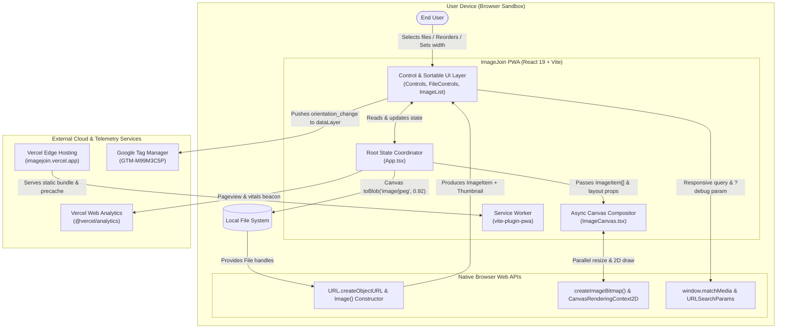
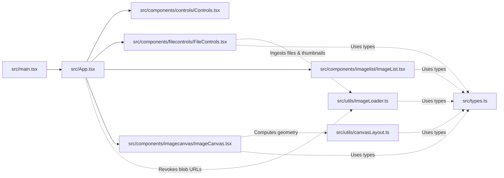
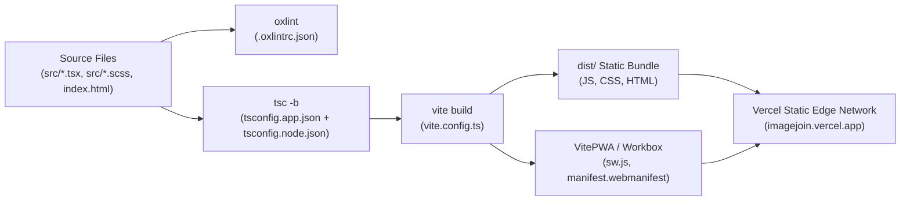

# ImageJoin Architecture Documentation

## 1. Executive Summary

**ImageJoin** (`imagejoinvite`) is a client-side Progressive Web Application (PWA) designed to combine, stack, scale, and arrange multiple images directly inside the browser using the HTML5 Canvas 2D API and the modern asynchronous `createImageBitmap` rendering pipeline. Built with React 19, TypeScript 6, and Vite 8, the application executes all image decoding, aspect-ratio normalization, thumbnail generation, and final JPEG encoding locally on the user's device without requiring backend storage or server-side image processing.

The architecture prioritizes zero-server data privacy, responsive multi-device layout orchestration, and high-resolution rendering performance. By decoupling UI state management (such as intermediate text input and low-resolution drag-and-drop thumbnails) from expensive full-resolution canvas redraws, ImageJoin remains responsive even when manipulating large multi-megapixel source images.

| Aspect / Layer | Technology / Choice | Version / Specification | Role in Architecture |
| :--- | :--- | :--- | :--- |
| **UI Runtime** | React & React DOM | `^19.2.7` | Declarative component tree, state lifting, and effect lifecycle management |
| **Language & Type System** | TypeScript | `~6.0.2` (`ES2023` target) | Compile-time type safety with strict bundler resolution and erasable syntax enforcement |
| **Build Tool & Dev Server** | Vite & `@vitejs/plugin-react` | `^8.1.1` / `^6.0.3` | Oxc-powered fast HMR, ES module bundling, and asset pipeline |
| **PWA & Offline Support** | `vite-plugin-pwa` | `^1.3.0` | Service worker auto-update registration and Web App Manifest generation |
| **Drag-and-Drop Engine** | `@dnd-kit/react` & `@dnd-kit/helpers` | `^0.5.0` | Accessible pointer/touch sortable list reordering for uploaded image items |
| **Rendering Engine** | HTML5 Canvas 2D + `createImageBitmap` | Browser Native Web API | Asynchronous hardware-accelerated image scaling (`resizeQuality: 'high'`) and compositing |
| **Styling System** | Sass (`sass-embedded`) + HTML5 Boilerplate CSS | `^1.100.0` | CSS custom properties, SCSS mixins, and mobile-first responsive media queries |
| **Static Analysis / Linting** | Oxlint | `^1.71.0` | High-speed Rust-based linting enforcing React hooks and component export rules |
| **Testing Framework** | Vitest + React Testing Library + jsdom | `^5.1.2` / `^16.3.3` / `^31.0.1` | Unit, component, and DOM integration tests for utilities, canvas math, and UI workflows |
| **Telemetry & Analytics** | Vercel Analytics & Google Tag Manager | `^2.0.1` / `GTM-M99M3C5P` | Pageview telemetry, performance monitoring, and custom `dataLayer` interaction events |

---

## 2. Repository Layout

The workspace follows a flat, modular single-page application structure with separated TypeScript compiler configurations for application code (`src/`) and Node-based build tooling ([`vite.config.ts`](./vite.config.ts)).

```text
imagejoin-react/
├── .oxlintrc.json                    # Oxlint static analysis rule and plugin configuration
├── .yarnrc.yml                       # Yarn 4 configuration (nodeLinker: node-modules)
├── ARCHITECTURE.md                   # Comprehensive system architecture and component manual
├── index.html                        # Entry HTML shell, SEO/OpenGraph metadata, and GTM bootstrap
├── package.json                      # Project manifest, scripts, and dependency declarations
├── yarn.lock                         # Yarn dependency lockfile
├── tsconfig.json                     # Solution-style TypeScript root config referencing app and node targets
├── tsconfig.app.json                 # TypeScript config for browser/DOM source code under src/
├── tsconfig.node.json                # TypeScript config for Vite & Vitest build configuration (Node environment)
├── vite.config.ts                    # Vite bundler and Progressive Web App manifest configuration
├── vitest.config.ts                  # Vitest + jsdom test runner configuration
├── public/                           # Static unbundled assets copied directly to dist root
│   ├── apple-touch-icon-180x180.png  # iOS home screen icon
│   ├── favicon.ico                   # Legacy browser favicon (48x48)
│   ├── icon.svg                      # Scalable vector application icon
│   ├── maskable-icon-512x512.png     # Android adaptive maskable PWA icon
│   ├── pwa-64x64.png                 # Standard 64x64 PWA manifest icon
│   ├── pwa-192x192.png               # Standard 192x192 PWA manifest icon
│   ├── pwa-512x512.png               # Standard 512x512 PWA manifest icon
│   ├── img/
│   │   └── og-image.jpg              # OpenGraph and Twitter Card social preview banner
│   └── testimg/                      # Local-only test fixtures (git-ignored) for Debug mode
└── src/                              # Application source code
    ├── main.tsx                      # React 19 DOM root creation and StrictMode mounting
    ├── App.tsx                       # Root stateful container, URL debug parser, and download handler
    ├── App.test.tsx                  # End-to-end App upload, debug gating, and download tests
    ├── App.scss                      # Design tokens, layout rules, and responsive breakpoint styles
    ├── index.css                     # HTML5 Boilerplate v9.0.1 base reset and utility classes
    ├── types.ts                      # Core domain data contracts (ImageItem, Orientation)
    ├── test/
    │   ├── fixtures.ts               # Shared ImageItem, Canvas 2D, and matchMedia test helpers
    │   └── setup.ts                  # Vitest DOM setup, ResizeObserver stub, and cleanup hooks
    ├── components/
    │   ├── controls/
    │   │   └── Controls.tsx          # Composition sidebar layout wrapper (#controls.controls)
    │   ├── filecontrols/
    │   │   ├── FileControls.tsx      # File ingestion triggers, orientation buttons, and parameter controls
    │   │   └── FileControls.test.tsx # File upload, width buffering, and orientation control tests
    │   ├── imagecanvas/
    │   │   ├── ImageCanvas.tsx       # Parallel createImageBitmap compositor and canvas lifecycle
    │   │   └── ImageCanvas.test.tsx  # Parallel resampling, bitmap cleanup, fallback, and cancellation tests
    │   └── imagelist/
    │       ├── ImageList.tsx         # Sortable thumbnail queue with drag-and-drop and arrow controls
    │       └── ImageList.test.tsx    # Arrow reordering, thumbnail rendering, and matchMedia tests
    └── utils/
        ├── canvasLayout.ts           # Pure Portrait/Landscape dimension math and drawQueue builder
        ├── canvasLayout.test.ts      # Unit tests for Portrait/Landscape/CustomWidth layout formulas
        ├── imageLoader.ts            # Object URL file ingestion, thumbnail generation, and URL revocation
        └── imageLoader.test.ts       # Unit tests for thumbnail scaling, Object URL batching, and cleanup
```

### Configuration & Workspace Files

| File | Purpose & Architectural Significance |
| :--- | :--- |
| [`package.json`](./package.json) | Declares ESM package mode (`"type": "module"`), scripts (`dev`, `build`, `lint`, `preview`, `test`, `test:watch`), runtime dependencies, and build toolchains. |
| [`vite.config.ts`](./vite.config.ts) | Configures the React Oxc plugin (`@vitejs/plugin-react`) and `VitePWA` with `registerType: 'autoUpdate'` and full icon manifest definitions. |
| [`vitest.config.ts`](./vitest.config.ts) | Configures Vitest with the `jsdom` environment, `@testing-library/jest-dom` setup, and test discovery under [`src/`](./src). |
| [`tsconfig.json`](./tsconfig.json) | Root project references file delegating compilation checks to [`tsconfig.app.json`](./tsconfig.app.json) and [`tsconfig.node.json`](./tsconfig.node.json). |
| [`tsconfig.app.json`](./tsconfig.app.json) | Configures `ES2023` + `DOM` libs, `bundler` module resolution, `react-jsx` transform, `verbatimModuleSyntax`, and `erasableSyntaxOnly` for [`src/`](./src). |
| [`tsconfig.node.json`](./tsconfig.node.json) | Isolates Node-specific type checking (`nodenext`) strictly to [`vite.config.ts`](./vite.config.ts) and [`vitest.config.ts`](./vitest.config.ts). |
| [`.oxlintrc.json`](./.oxlintrc.json) | Enables `react`, `typescript`, and `oxc` lint plugins, enforcing `react/rules-of-hooks` (`error`) and `react/only-export-components` (`warn`). |
| [`.yarnrc.yml`](./.yarnrc.yml) | Configures Yarn 4 with `nodeLinker: node-modules` for Vite 8 compatibility. |
| [`index.html`](./index.html) | Mounts `#root`, injects the Google Tag Manager (`GTM-M99M3C5P`) script and `<noscript>` fallback, and defines OpenGraph/Twitter/PWA metadata. |
| [`.gitignore`](./.gitignore) | Excludes build artifacts (`dist/`), dependencies (`node_modules/`), Vitest cache (`.vitest`), local debug fixtures (`public/testimg`), and local agent files (`.agents/`, `AGENTS.md`, `skills-lock.json`). |

---

## 3. System Context

ImageJoin operates as a standalone, browser-hosted Single Page Application (SPA) and Progressive Web Application (PWA). All core image processing stays within the browser's execution sandbox, interacting only with local host filesystem APIs for file selection and image export, and with external telemetry endpoints for usage analytics.



### External Boundaries & Interfaces

| Boundary | Direction | Protocol / Mechanism | Data Exchanged |
| :--- | :--- | :--- | :--- |
| **User File Ingestion** | Inbound (`LocalFS -> App`) | HTML `<input type="file" multiple>` + `URL.createObjectURL` | Local raster image files mapped to in-memory `blob:` Object URLs and `HTMLImageElement` instances without Base64 duplication. |
| **Joined Image Export** | Outbound (`App -> LocalFS`) | `HTMLCanvasElement.toBlob('image/jpeg', 0.92)` (with `toDataURL` fallback) + synthetic `<a download>` click | Composited JPEG Blob URL saved directly to the user's downloads folder as `<filename>.jpg`. |
| **Google Tag Manager** | Outbound (`App -> GTM`) | `window.dataLayer.push()` via GTM script in [`index.html`](./index.html#L6-L20) | Lifecycle events and custom `orientation_change` events containing `selected_orientation`. |
| **Vercel Analytics** | Outbound (`App -> Vercel`) | `<Analytics />` component in [`src/App.tsx`](./src/App.tsx#L98) | Anonymous web vitals and pageview telemetry. |
| **PWA Service Worker** | Bidirectional (`Browser <-> CDN`) | `vite-plugin-pwa` (`registerType: 'autoUpdate'`) | Static asset precaching, offline execution capability, and manifest metadata. |

---

## 4. Execution Flow

The primary operational lifecycle of ImageJoin spans four stages:
1. **Initialization & Environment Detection**: Parsing query parameters (`?debug=true`) and mounting the React 19 component tree.
2. **Image Ingestion & Thumbnail Downsampling**: Mapping user-selected `File` objects to local `blob:` Object URLs, decoding image dimensions concurrently, and generating compressed 100px-wide JPEG thumbnails via an offscreen canvas.
3. **Interactive Arrangement & Layout Calculation**: Reordering items via `@dnd-kit/react` or directional buttons, adjusting orientation (`portrait` vs. `landscape`), and computing normalized scaling factors in [`computeCanvasLayout`](./src/utils/canvasLayout.ts#L21-L80).

```mermaid
sequenceDiagram
    autonumber
    actor User
    participant FC as FileControls.tsx
    participant IL as ImageList.tsx
    participant App as App.tsx
    participant IC as ImageCanvas.tsx
    participant WebAPI as Browser Canvas & Bitmap API

    User->>FC: Selects multiple files (<input type="file">)
    loop Per selected File (Promise.all in imageLoader.ts)
        FC->>WebAPI: URL.createObjectURL(file)
        WebAPI-->>FC: Local blob: Object URL (src)
        FC->>WebAPI: Decode via new Image()
        WebAPI-->>FC: HTMLImageElement (width, height)
        FC->>WebAPI: Offscreen canvas drawImage (maxWidth=100, JPEG q=0.5)
        WebAPI-->>FC: Compressed thumbnailSrc Data URL
    end
    FC->>App: onReplaceImages(loadedImages) -> revokes prior blob: URLs

    App->>IL: Render sortable thumbnails (thumbnailSrc)
    App->>IC: Trigger useEffect([images, orientation, scaleToLargest, customWidth])

    IC->>IC: computeCanvasLayout() builds drawQueue [{img, x, y, w, h}]
    IC->>App: setCanvasWidth(canvas.width)

    par Parallel resampling in drawHighQuality()
        IC->>WebAPI: Promise.all(createImageBitmap(img, "{resizeWidth, resizeHeight, resizeQuality: 'high'}"))
        WebAPI-->>IC: ImageBitmap[] (or null on DOMException)
    end

    alt isActive is still true
        loop Ordered item in drawQueue
            alt ImageBitmap available
                IC->>WebAPI: ctx.drawImage(bitmap, x, y) then bitmap.close()
            else Encoding fallback
                IC->>WebAPI: ctx.drawImage(img, x, y, w, h) with imageSmoothingQuality='high'
            end
        end
    else Stale render cancelled
        IC->>WebAPI: bitmap.close() for all decoded bitmaps
    end

    opt User reorders images or changes parameters
        User->>IL: Drag item or click Up/Down arrow
        IL->>App: setImages(reorderedImages)
        App->>IC: Re-run useEffect (aborts stale draw via isActive = false)
    end

    User->>FC: Clicks "Download image"
    FC->>App: onDownload() -> handleDownload()
    App->>WebAPI: canvas.toBlob(cb, 'image/jpeg', 0.92) + URL.createObjectURL(blob)
    WebAPI-->>App: Composited JPEG Blob URL
    App->>User: Synthetic <a download="{filename}.jpg"> click + revokeObjectURL
```

4. **Parallel High-Quality Compositing & Export**: Resizing all queued images concurrently using `createImageBitmap` with `resizeQuality: 'high'`, painting onto the shared `<canvas>`, immediately releasing bitmaps via `bitmap.close()`, and exporting the final composite via `canvas.toBlob`.



---

## 5. Core Components



### 5.1 Application Bootstrap & Root State ([`src/main.tsx`](./src/main.tsx), [`src/App.tsx`](./src/App.tsx), [`src/types.ts`](./src/types.ts))

- **Entry Point ([`src/main.tsx`](./src/main.tsx#L1-L10))**: Mounts `<App />` inside `<StrictMode>` onto `#root` after importing global styles from [`src/index.css`](./src/index.css).
- **Domain & Telemetry Contracts ([`src/types.ts`](./src/types.ts#L1-L24))**:
  - `ImageItem` ([`src/types.ts`](./src/types.ts#L1-L9)): Encapsulates a loaded image's lifecycle data: unique `id` (`crypto.randomUUID()`), full-resolution `src` (Object URL or asset path), downsampled `thumbnailSrc`, `originalName`, natural `width` and `height`, and the decoded `imgElement` (`HTMLImageElement`).
  - `Orientation` ([`src/types.ts`](./src/types.ts#L11)): Union type `'portrait' | 'landscape'` governing vertical vs. horizontal stacking.
  - `OrientationChangeEvent`, `DataLayerEntry`, and `Window.dataLayer` ([`src/types.ts`](./src/types.ts#L13-L24)): Strictly typed GTM telemetry contracts replacing `any[]`.
- **Root State Coordinator ([`src/App.tsx`](./src/App.tsx#L18-L103))**:
  - **Debug Mode Resolution ([`src/App.tsx`](./src/App.tsx#L19-L23))**: Evaluates `window.location.search` for `debug`. Debug mode is enabled automatically in Vite dev mode (`import.meta.env.DEV`) unless `?debug=false` is passed, or in non-Vercel deployments when `?debug=true` is explicitly provided.
  - **Lifted State & Composition ([`src/App.tsx`](./src/App.tsx#L25-L39), [`src/App.tsx`](./src/App.tsx#L71-L96))**: Holds `images`, `orientation` (default `'portrait'`), `scaleToLargest` (default `true`), `filename`, `canvasWidth`, `customWidth`, and `canvasRef`. Composes `FileControls` and `ImageList` directly inside `Controls`, and exposes `replaceImages()` to revoke superseded `blob:` URLs via `revokeImageUrls(prev)` before replacing state.
  - **Export Handler ([`src/App.tsx`](./src/App.tsx#L41-L65))**: `handleDownload()` reads `canvasRef.current`, defaults blank filenames to `'joinedimage'`, encodes the canvas asynchronously via `canvas.toBlob(..., 'image/jpeg', 0.92)` into a temporary Object URL (with synchronous `toDataURL('image/jpeg', 0.92)` fallback), and triggers download via `triggerDownload()` ([`src/App.tsx`](./src/App.tsx#L11-L16)).

### 5.2 Control Panel & Ingestion Pipeline ([`src/components/controls/Controls.tsx`](./src/components/controls/Controls.tsx), [`src/components/filecontrols/FileControls.tsx`](./src/components/filecontrols/FileControls.tsx), [`src/utils/imageLoader.ts`](./src/utils/imageLoader.ts))

- **Sidebar Wrapper ([`src/components/controls/Controls.tsx`](./src/components/controls/Controls.tsx#L3-L15))**: Stateless composition container (`#controls.controls`) rendering `children`.
- **Image Loader & Thumbnail Utility ([`src/utils/imageLoader.ts`](./src/utils/imageLoader.ts#L7-L71))**:
  - `generateThumbnail(img, maxWidth = 100)` ([`src/utils/imageLoader.ts`](./src/utils/imageLoader.ts#L7-L19)): Renders a 100px max-width downscaled image onto an ephemeral `<canvas>` and exports a lightweight JPEG (`quality = 0.5`).
  - `loadImage(src, name)` ([`src/utils/imageLoader.ts`](./src/utils/imageLoader.ts#L24-L42)): Decodes an `HTMLImageElement`, generates its thumbnail, and assigns `crypto.randomUUID()`.
  - `loadImageFiles(files)` ([`src/utils/imageLoader.ts`](./src/utils/imageLoader.ts#L48-L60)): Maps selected files to `URL.createObjectURL(file)`, decodes them concurrently, and revokes the entire batch's Object URLs if any file fails to load.
  - `revokeImageUrls(images)` ([`src/utils/imageLoader.ts`](./src/utils/imageLoader.ts#L65-L71)): Revokes `blob:` URLs while ignoring static debug fixture paths.
- **File & Parameter Controls ([`src/components/filecontrols/FileControls.tsx`](./src/components/filecontrols/FileControls.tsx#L30-L239))**:
  - `handleFileUpload` ([`src/components/filecontrols/FileControls.tsx`](./src/components/filecontrols/FileControls.tsx#L55-L65)): Invokes `loadImageFiles(files)`, commits via `onReplaceImages(loadedImages)`, and resets `e.target.value = ''`.
  - **Debug Fixture Loader ([`src/components/filecontrols/FileControls.tsx`](./src/components/filecontrols/FileControls.tsx#L5-L12), [`src/components/filecontrols/FileControls.tsx`](./src/components/filecontrols/FileControls.tsx#L67-L82))**: When `debug` is active, toggling `#debugToggle` loads six paths from `TEST_IMAGES`.
  - **Accessible Orientation Toggle ([`src/components/filecontrols/FileControls.tsx`](./src/components/filecontrols/FileControls.tsx#L84-L91), [`src/components/filecontrols/FileControls.tsx`](./src/components/filecontrols/FileControls.tsx#L144-L170))**: Renders `#orientationButtons` (`role="group"`) with `aria-label`, `aria-pressed`, and `.active` state for `'portrait'` and `'landscape'`, pushing `orientation_change` events to `window.dataLayer`.
  - **Buffered Custom Width State ([`src/components/filecontrols/FileControls.tsx`](./src/components/filecontrols/FileControls.tsx#L48-L53), [`src/components/filecontrols/FileControls.tsx`](./src/components/filecontrols/FileControls.tsx#L97-L119))**: Buffers keystrokes in `localWidth` (syncing cleanly during render when parent `customWidth` changes via `prevCustomWidth`, avoiding `setState` in an effect). Pressing `Enter` or clicking `Go` validates `parseInt(val, 10) > 0` before committing, and disables `#scaleCheckbox` while active ([`src/components/filecontrols/FileControls.tsx`](./src/components/filecontrols/FileControls.tsx#L172-L182)).

### 5.3 Canvas Layout Math & Rendering Engine ([`src/utils/canvasLayout.ts`](./src/utils/canvasLayout.ts), [`src/components/imagecanvas/ImageCanvas.tsx`](./src/components/imagecanvas/ImageCanvas.tsx))

[`computeCanvasLayout`](./src/utils/canvasLayout.ts#L21-L80) computes target canvas dimensions and `drawQueue` placements synchronously, while [`ImageCanvas`](./src/components/imagecanvas/ImageCanvas.tsx#L14-L99) applies those dimensions and executes parallel asynchronous bitmap resampling:

| Orientation Mode | Width Mode | Target Base Dimension Formula | Individual Image Scaling Formula | Final Canvas Dimensions |
| :--- | :--- | :--- | :--- | :--- |
| **Portrait** (Vertical Stack) ([`src/utils/canvasLayout.ts`](./src/utils/canvasLayout.ts#L40-L58)) | Auto (`customWidth` empty) | $W_{\text{base}} = \max(W_i)$ if `scaleToLargest` else $\min(W_i)$ | $s_i = \frac{W_{\text{base}}}{W_i}, \quad H'_i = H_i \cdot s_i$ | $W_{\text{canvas}} = W_{\text{base}}$<br>$H_{\text{canvas}} = \sum H'_i$ |
| **Portrait** (Vertical Stack) ([`src/utils/canvasLayout.ts`](./src/utils/canvasLayout.ts#L40-L58)) | Custom (`parsedCustomWidth > 0`) | $W_{\text{base}} = W_{\text{custom}}$ | $s_i = \frac{W_{\text{custom}}}{W_i}, \quad H'_i = H_i \cdot s_i$ | $W_{\text{canvas}} = W_{\text{custom}}$<br>$H_{\text{canvas}} = \sum H'_i$ |
| **Landscape** (Horizontal Row) ([`src/utils/canvasLayout.ts`](./src/utils/canvasLayout.ts#L60-L79)) | Auto (`customWidth` empty) | $H_{\text{base}} = \max(H_i)$ if `scaleToLargest` else $\min(H_i)$ | $s_i = \frac{H_{\text{base}}}{H_i}, \quad W'_i = W_i \cdot s_i$ | $W_{\text{canvas}} = \sum W'_i$<br>$H_{\text{canvas}} = H_{\text{base}}$ |
| **Landscape** (Horizontal Row) ([`src/utils/canvasLayout.ts`](./src/utils/canvasLayout.ts#L60-L79)) | Custom (`parsedCustomWidth > 0`) | $H_{\text{base}} = \frac{W_{\text{custom}}}{\sum (W_i / H_i)}$ | $s_i = \frac{H_{\text{base}}}{H_i}, \quad W'_i = W_i \cdot s_i$ | $W_{\text{canvas}} = \sum W'_i = W_{\text{custom}}$<br>$H_{\text{canvas}} = H_{\text{base}}$ |

- **Parallel Resampling, Bitmap Disposal & Cancellation ([`src/components/imagecanvas/ImageCanvas.tsx`](./src/components/imagecanvas/ImageCanvas.tsx#L24), [`src/components/imagecanvas/ImageCanvas.tsx`](./src/components/imagecanvas/ImageCanvas.tsx#L43-L89))**: `drawHighQuality()` resamples all `drawQueue` items concurrently via `Promise.all`, checks `isActive` before painting, and guarantees `bitmap.close()` in both the active draw `finally` block and the cancelled-render cleanup path.
- **High-Quality Fallback ([`src/components/imagecanvas/ImageCanvas.tsx`](./src/components/imagecanvas/ImageCanvas.tsx#L48-L81))**: If `createImageBitmap` rejects for an image encoding, the catch branch returns `null` for that bitmap and falls back to `ctx.drawImage(item.img, item.x, item.y, item.w, item.h)` with `ctx.imageSmoothingEnabled = true` and `ctx.imageSmoothingQuality = 'high'`.

### 5.4 Sortable Image Queue ([`src/components/imagelist/ImageList.tsx`](./src/components/imagelist/ImageList.tsx))

- **`SortableImageItem` ([`src/components/imagelist/ImageList.tsx`](./src/components/imagelist/ImageList.tsx#L22-L70))**: Binds each image entry to `@dnd-kit/react/sortable` via `useSortable({ id, index })`. Displays accessible up/down arrow buttons (`type="button"`, `aria-label="Move <name> up/down"`), the compressed `img.thumbnailSrc` with context-menu suppression (`onContextMenu={(e) => e.preventDefault()}`), and the truncated `originalName`.
- **`ImageList` ([`src/components/imagelist/ImageList.tsx`](./src/components/imagelist/ImageList.tsx#L79-L139))**:
  - Wraps items in `<DragDropProvider onDragEnd={handleDragEnd}>` ([`src/components/imagelist/ImageList.tsx`](./src/components/imagelist/ImageList.tsx#L100-L103), [`src/components/imagelist/ImageList.tsx`](./src/components/imagelist/ImageList.tsx#L117)), typing `handleDragEnd` via `ComponentProps<typeof DragDropProvider>['onDragEnd']` and delegating drag reordering to `move(prevImages, event)` from `@dnd-kit/helpers`.
  - Provides explicit button reordering via `swapImages`, `moveUp`, and `moveDown` ([`src/components/imagelist/ImageList.tsx`](./src/components/imagelist/ImageList.tsx#L84-L98)) for keyboard/mobile accessibility.
  - Lazily initializes `#helpText` from `window.matchMedia('(max-width: 600px)').matches` and subscribes to `change` events ([`src/components/imagelist/ImageList.tsx`](./src/components/imagelist/ImageList.tsx#L80-L82), [`src/components/imagelist/ImageList.tsx`](./src/components/imagelist/ImageList.tsx#L105-L113)).

---

## 6. Design Decisions

| Decision | Rationale | Trade-off |
| :--- | :--- | :--- |
| **100% Client-Side Canvas Processing** ([`src/components/imagecanvas/ImageCanvas.tsx`](./src/components/imagecanvas/ImageCanvas.tsx#L43-L83)) | Eliminates server bandwidth costs, backend infrastructure complexity, and user privacy concerns by keeping all image bytes in local browser memory. | Maximum image resolution and batch size are constrained by the client device's RAM and browser-enforced maximum `<canvas>` dimensions (typically 16,384px–32,767px per axis). |
| **Object URL Ingestion & `toBlob` Export** ([`src/utils/imageLoader.ts`](./src/utils/imageLoader.ts#L48-L71), [`src/App.tsx`](./src/App.tsx#L41-L65)) | Avoids ~33% Base64 encoding overhead on upload and prevents synchronous main-thread Data URL string blocking on export. | Requires explicit `URL.revokeObjectURL` management in `replaceImages()` ([`src/App.tsx`](./src/App.tsx#L34-L39)) rather than effect cleanup to stay safe under React 19 StrictMode. |
| **Dual-Resolution Image State (`src` vs `thumbnailSrc`)** ([`src/types.ts`](./src/types.ts#L3-L4), [`src/utils/imageLoader.ts`](./src/utils/imageLoader.ts#L7-L19)) | Decoding and painting multi-megapixel images inside draggable DOM nodes causes layout thrashing and GPU memory spikes during drag gestures. Generating a 100px JPEG thumbnail (`q=0.5`) at upload time keeps list interactions at 60fps. | Adds a small upfront CPU/canvas cost during initial file upload and stores a tiny secondary Data URL string per image in memory. |
| **Parallel `createImageBitmap` Resampling with Explicit `close()`** ([`src/components/imagecanvas/ImageCanvas.tsx`](./src/components/imagecanvas/ImageCanvas.tsx#L44-L82)) | Standard 2D `ctx.drawImage` downscaling in many browsers produces aliasing artifacts. Running `createImageBitmap` (`resizeQuality: 'high'`) concurrently via `Promise.all` speeds up multi-image redraws while `bitmap.close()` frees GPU textures immediately. | Asynchronous decoding requires an `isActive` cancellation flag to dispose stale bitmaps and prevent out-of-order writes. |
| **Deferred Custom Width Commit (`localWidth` vs `customWidth`)** ([`src/components/filecontrols/FileControls.tsx`](./src/components/filecontrols/FileControls.tsx#L48-L53), [`src/components/filecontrols/FileControls.tsx`](./src/components/filecontrols/FileControls.tsx#L97-L119)) | Re-running `createImageBitmap` on every keystroke (e.g., typing `"1"`, `"19"`, `"192"`, `"1920"`) would trigger intermediate 1px and 19px canvas renders and waste CPU cycles. | Users must press `Enter` or click the `Go` button to apply a custom width rather than seeing live keystroke-by-keystroke resizing. |
| **Aspect-Ratio Summation for Landscape Custom Width** ([`src/utils/canvasLayout.ts`](./src/utils/canvasLayout.ts#L60-L62)) | In horizontal (`landscape`) mode, images share a common row height $H_{\text{base}}$ while their widths sum to $W_{\text{custom}}$. Computing $H_{\text{base}} = W_{\text{custom}} / \sum(W_i / H_i)$ mathematically guarantees that the joined row width equals $W_{\text{custom}}$ without distorting any image's aspect ratio. | Adding many wide images to a fixed-width landscape row proportionally reduces the shared row height $H_{\text{base}}$. |
| **Lifted State with Composition in `App.tsx`** ([`src/App.tsx`](./src/App.tsx#L25-L39), [`src/App.tsx`](./src/App.tsx#L71-L88)) | Keeps root state (`images`, `orientation`, `scaleToLargest`, `filename`, `customWidth`) explicit in `App.tsx` while passing `FileControls` and `ImageList` as `children` into `Controls`, eliminating prop-drilling boilerplate. | Adding deeply nested siblings in the future would require moving shared state into React Context. |

---

## 7. Deployment & Environment

### Build Pipeline & Tooling



### Yarn Lifecycle Scripts

| Command ([`package.json`](./package.json#L6-L13)) | Underlying Execution | Purpose |
| :--- | :--- | :--- |
| `yarn dev` | `vite` | Launches the local Vite development server with HMR and activates `import.meta.env.DEV` (enabling the Debug UI toggle by default). |
| `yarn build` | `tsc -b && vite build` | Runs TypeScript composite project verification across both `tsconfig.app.json` and `tsconfig.node.json`, then bundles production assets and generates the PWA service worker into `dist/`. |
| `yarn lint` | `oxlint` | Executes Rust-powered static analysis using rules from [`.oxlintrc.json`](./.oxlintrc.json). |
| `yarn preview` | `vite preview` | Serves the production `dist/` directory locally to verify PWA service worker registration and bundled behavior. |
| `yarn test` | `vitest run` | Runs the Vitest unit and component integration test suite once in `jsdom`. |
| `yarn test:watch` | `vitest` | Runs Vitest in interactive watch mode during development. |

### Operational Prerequisites & Environment Variables

- **Node.js & Package Manager**: Uses ES Modules (`"type": "module"`) managed via Yarn 4 (`yarn@4.18.1`) configured with `nodeLinker: node-modules` in [`.yarnrc.yml`](./.yarnrc.yml) and [`yarn.lock`](./yarn.lock).
- **Hosting Target**: Deployed as a static site on Vercel (`https://imagejoin.vercel.app`), referenced in OpenGraph/Twitter tags in [`index.html`](./index.html#L36-L62) and hostname checks in [`src/App.tsx`](./src/App.tsx#L21-L23).
- **Runtime Flags**:
  - `import.meta.env.DEV` ([`src/App.tsx`](./src/App.tsx#L22)): Automatically injected by Vite; controls default visibility of `#debugContainer`.
  - `?debug=true` / `?debug=false` ([`src/App.tsx`](./src/App.tsx#L20-L23)): URL query parameter to override debug fixture controls in non-Vercel environments.

---

## 8. Security & Privacy

Because ImageJoin is an offline-capable client-side utility, its security posture centers on browser sandbox isolation and strict zero-upload image handling:

1. **Zero Remote Image Transmission**:
   - User-uploaded files are mapped strictly to local `blob:` Object URLs via `URL.createObjectURL()` ([`src/utils/imageLoader.ts`](./src/utils/imageLoader.ts#L48-L60)) and decoded into local `HTMLImageElement` instances. No image binary data, filenames, or canvas outputs are ever transmitted over the network.
2. **Trust Boundaries & Third-Party Scripts**:
   - **Google Tag Manager (`GTM-M99M3C5P`)**: Loaded asynchronously from `https://www.googletagmanager.com/gtm.js` in [`index.html`](./index.html#L6-L20). Only high-level UI metadata (`event: 'orientation_change'`, `selected_orientation`) is pushed to `window.dataLayer` ([`src/components/filecontrols/FileControls.tsx`](./src/components/filecontrols/FileControls.tsx#L84-L91)).
   - **Vercel Analytics**: Mounted via `<Analytics />` ([`src/App.tsx`](./src/App.tsx#L98)) for aggregate performance and pageview metrics.
3. **Input Validation & Sanitization**:
   - **Custom Width Parsing**: User input in `#customWidth` is sanitized via `parseInt(val, 10)` and strictly checked for `!isNaN(parsed) && parsed > 0` before reaching the canvas sizing engine ([`src/components/filecontrols/FileControls.tsx`](./src/components/filecontrols/FileControls.tsx#L105-L111) and [`src/utils/canvasLayout.ts`](./src/utils/canvasLayout.ts#L36-L37)).
   - **Download Filename Handling**: Export filenames are trimmed via `filename.trim() || 'joinedimage'` and assigned to the `download` attribute of an in-memory `<a>` element ([`src/App.tsx`](./src/App.tsx#L11-L16), [`src/App.tsx`](./src/App.tsx#L45-L64)), which browsers automatically sanitize against path traversal characters.
   - **Production Debug Gating**: The debug fixture toggle is explicitly blocked on production Vercel domains via `!window.location.href.includes('vercel')` ([`src/App.tsx`](./src/App.tsx#L21-L23)).

---

## 9. Performance Characteristics

| Subsystem | BottleneckType | Mechanism & Optimization Strategy | Code Reference |
| :--- | :--- | :--- | :--- |
| **File Ingestion & Decoding** | I/O + Memory | Maps files to zero-copy `URL.createObjectURL(file)` handles and decodes concurrently via `Promise.all`, revoking superseded `blob:` URLs on replacement. | [`src/utils/imageLoader.ts`](./src/utils/imageLoader.ts#L48-L71), [`src/App.tsx`](./src/App.tsx#L34-L39) |
| **Sortable List Rendering** | DOM / GPU Memory | Downsamples every uploaded image immediately to a max-width 100px JPEG (`quality = 0.5`) stored in `thumbnailSrc`, reducing thumbnail memory footprint by >99%. | [`src/utils/imageLoader.ts`](./src/utils/imageLoader.ts#L7-L19), [`src/components/imagelist/ImageList.tsx`](./src/components/imagelist/ImageList.tsx#L50-L55) |
| **High-Resolution Resampling** | CPU / GPU | Resamples all `drawQueue` items concurrently via `Promise.all(createImageBitmap(..., { resizeQuality: 'high' }))` and releases GPU textures immediately with `bitmap.close()`. | [`src/components/imagecanvas/ImageCanvas.tsx`](./src/components/imagecanvas/ImageCanvas.tsx#L44-L82) |
| **Rapid Reorder Cancellation** | Concurrency / CPU | Aborts stale `drawHighQuality()` commits via the `isActive` effect cleanup flag and closes any decoded bitmaps from cancelled renders. | [`src/components/imagecanvas/ImageCanvas.tsx`](./src/components/imagecanvas/ImageCanvas.tsx#L24), [`src/components/imagecanvas/ImageCanvas.tsx`](./src/components/imagecanvas/ImageCanvas.tsx#L60-L89) |
| **Width Input Isolation** | React Re-render Prevention | Buffers keystrokes in `localWidth` inside `FileControls` so `ImageCanvas` only recalculates when the user commits via `Enter` or `Go`. | [`src/components/filecontrols/FileControls.tsx`](./src/components/filecontrols/FileControls.tsx#L48-L53), [`src/components/filecontrols/FileControls.tsx`](./src/components/filecontrols/FileControls.tsx#L97-L119) |
| **JPEG Export Encoding** | Memory / Main Thread | Encodes the final composite asynchronously via `canvas.toBlob(..., 'image/jpeg', 0.92)` into a temporary Object URL (falling back to `toDataURL` if unavailable). | [`src/App.tsx`](./src/App.tsx#L41-L65) |

### Known Resource Ceiling

- **Browser Canvas Limits**: Modern desktop and mobile browsers enforce hard limits on `<canvas>` backing store dimensions (commonly 16,384 $\times$ 16,384 pixels or ~268 megapixels total area). Stacking many unscaled 4K/8K images in portrait mode with `scaleToLargest = true` can exceed this ceiling unless a `customWidth` constraint is applied.

---

## 10. Troubleshooting

| Symptom | Cause | Fix |
| :--- | :--- | :--- |
| **Typing a number in the "Width" field does not resize the canvas** | `FileControls` buffers keystrokes in `localWidth` to prevent expensive canvas redraws on every character typed ([`src/components/filecontrols/FileControls.tsx`](./src/components/filecontrols/FileControls.tsx#L48-L53)). | Press the `Enter` key while focused in `#customWidth` or click the adjacent **Go** button to trigger `applyWidth()` ([`src/components/filecontrols/FileControls.tsx`](./src/components/filecontrols/FileControls.tsx#L97-L119)). |
| **"Resize to largest image" checkbox is greyed out and unclickable** | A custom width is currently active (`hasCustomWidth` is `true` when `localWidth.trim() !== ''`), which overrides automatic min/max base width selection ([`src/components/filecontrols/FileControls.tsx`](./src/components/filecontrols/FileControls.tsx#L121), [`src/components/filecontrols/FileControls.tsx`](./src/components/filecontrols/FileControls.tsx#L172-L182)). | Clear the text inside the **Width** input field and click **Go** (or press `Enter`) to reset `customWidth` to `''` (`Auto`). |
| **Toggling the "Debug" checkbox logs `Failed to load: testimg/...` and renders no images** | The `public/testimg` directory is excluded from version control in [`.gitignore`](./.gitignore#L5), so the six fixture paths in `TEST_IMAGES` ([`src/components/filecontrols/FileControls.tsx`](./src/components/filecontrols/FileControls.tsx#L5-L12)) are missing on fresh clones. | Create `public/testimg/` locally and populate it with the expected test images (`1.webp`, `2.webp`, `rect.png`, `rect2.png`, `triangle.png`, and `05063b2318e3dd0632eb34c1821f905db558b5cd17b32360ff517d2cfae15ec2.0.webp`). |
| **Debug checkbox does not appear when appending `?debug=true` on production** | [`src/App.tsx`](./src/App.tsx#L21-L23) explicitly blocks debug mode when the URL contains `"vercel"` (`!window.location.href.includes('vercel') && debugQuery === 'true'`). | Run the application locally via `yarn dev` or preview on a non-Vercel hostname with `?debug=true`. |
| **Downloaded image is blank or truncated when joining many high-resolution photos** | Total composited width or height exceeds the browser's maximum `<canvas>` backing store limit. | Enter a lower target pixel width (e.g., `2000` or `4000`) in the **Width** field and click **Go**, or uncheck **Resize to largest image** so images scale to the smallest source dimension. |
| **Canvas renders with standard smoothing instead of `createImageBitmap`** | Fractional pixel dimensions or unsupported colour profiles caused `createImageBitmap` to throw a `DOMException` in strict browser engines. | Handled automatically by the `try / catch` block in [`src/components/imagecanvas/ImageCanvas.tsx`](./src/components/imagecanvas/ImageCanvas.tsx#L46-L81), which falls back to `ctx.drawImage` with `imageSmoothingQuality = 'high'`. |

---

## 11. Appendices

### 11.1 Reading Paths

| Persona | Recommended Section Sequence | Key Files to Inspect First |
| :--- | :--- | :--- |
| **New Contributor** | **1. Executive Summary** $\rightarrow$ **2. Repository Layout** $\rightarrow$ **4. Execution Flow** $\rightarrow$ **5. Core Components** | [`src/types.ts`](./src/types.ts), [`src/App.tsx`](./src/App.tsx), [`src/utils/imageLoader.ts`](./src/utils/imageLoader.ts), [`src/utils/canvasLayout.ts`](./src/utils/canvasLayout.ts) |
| **Operator / DevOps** | **1. Executive Summary** $\rightarrow$ **3. System Context** $\rightarrow$ **7. Deployment & Environment** $\rightarrow$ **10. Troubleshooting** | [`package.json`](./package.json), [`vite.config.ts`](./vite.config.ts), [`vitest.config.ts`](./vitest.config.ts), [`index.html`](./index.html) |
| **Architecture / Security Reviewer** | **3. System Context** $\rightarrow$ **5.3 Canvas Layout Math** $\rightarrow$ **6. Design Decisions** $\rightarrow$ **8. Security & Privacy** $\rightarrow$ **9. Performance Characteristics** | [`src/utils/canvasLayout.ts`](./src/utils/canvasLayout.ts), [`src/components/imagecanvas/ImageCanvas.tsx`](./src/components/imagecanvas/ImageCanvas.tsx), [`src/utils/imageLoader.ts`](./src/utils/imageLoader.ts) |

### 11.2 Glossary

| Term / Acronym | Definition in ImageJoin Context |
| :--- | :--- |
| **`baseWidth` / `baseHeight`** | The reference dimension (in pixels) to which all images in a stack are proportionally normalized before compositing ([`src/utils/canvasLayout.ts`](./src/utils/canvasLayout.ts#L41), [`src/utils/canvasLayout.ts`](./src/utils/canvasLayout.ts#L60-L62)). |
| **`canvasWidth`** | Read-only state reflecting the computed pixel width of the active `<canvas>`, surfaced as the `placeholder` inside the `#customWidth` input field ([`src/App.tsx`](./src/App.tsx#L29), [`src/components/filecontrols/FileControls.tsx`](./src/components/filecontrols/FileControls.tsx#L191)). |
| **`createImageBitmap`** | Modern browser Web API that asynchronously crops and resizes an image source in the background with configurable `resizeQuality` (`'high'`). |
| **`customWidth` vs `localWidth`** | `localWidth` is the uncommitted text string inside the Width `<input>`; `customWidth` is the validated positive integer string committed to `App` and `ImageCanvas` upon pressing `Enter` or clicking `Go`. |
| **`dataLayer`** | Typed global array (`window.dataLayer`) used by Google Tag Manager (`GTM-M99M3C5P`) to receive custom client interaction telemetry such as `orientation_change` ([`src/types.ts`](./src/types.ts#L13-L24)). |
| **`drawQueue`** | Synchronous pre-computed array of `{ img, x, y, w, h }` placement descriptors built by `computeCanvasLayout()` ([`src/utils/canvasLayout.ts`](./src/utils/canvasLayout.ts#L38-L79)) and consumed by `drawHighQuality()`. |
| **`ImageItem`** | Core TypeScript interface ([`src/types.ts`](./src/types.ts#L1-L9)) pairing a loaded `HTMLImageElement` and its full-resolution Object URL `src` with a compressed `thumbnailSrc` and natural dimensions. |
| **`Orientation`** | Layout axis union type (`'portrait' | 'landscape'`). `'portrait'` stacks images vertically (matching widths); `'landscape'` joins images side-by-side horizontally (matching heights). |
| **Oxlint** | Rust-based JavaScript/TypeScript linter from the Oxc project configured via [`.oxlintrc.json`](./.oxlintrc.json). |
| **`scaleToLargest`** | Boolean flag (`true` by default). When `true` (and no `customWidth` is set), smaller images are upscaled to match the largest image's base dimension; when `false`, larger images are downscaled to match the smallest image. |
